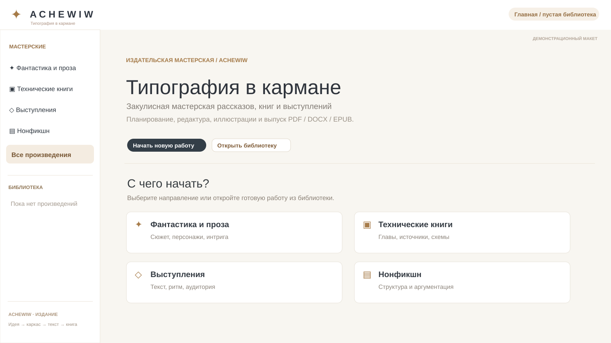
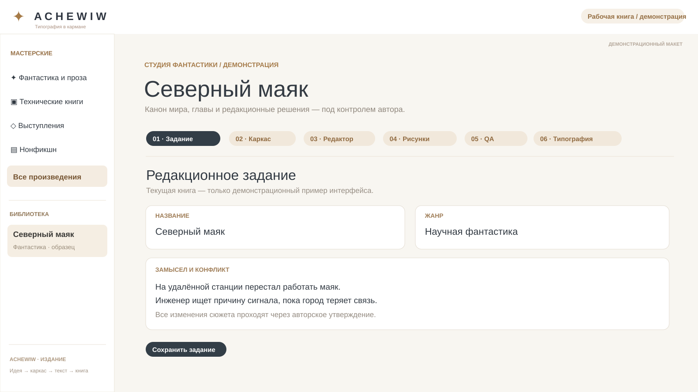
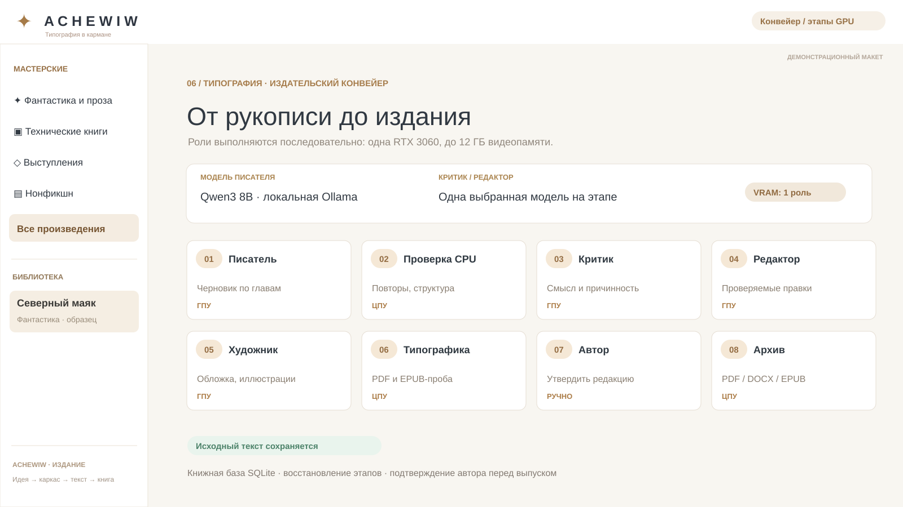
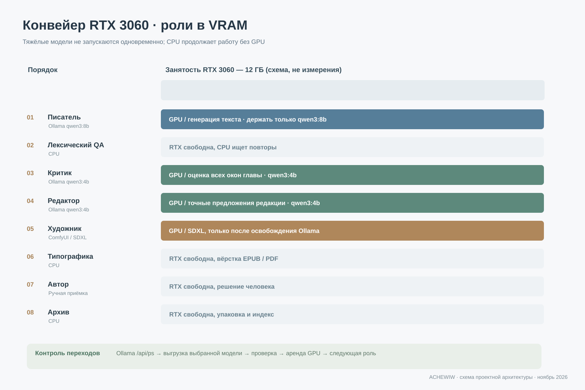
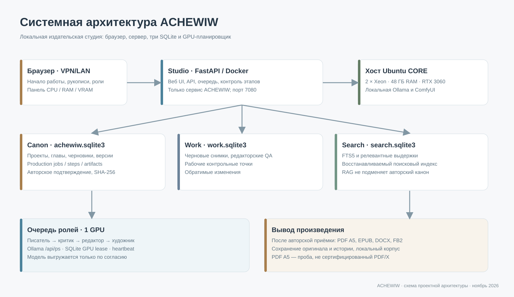
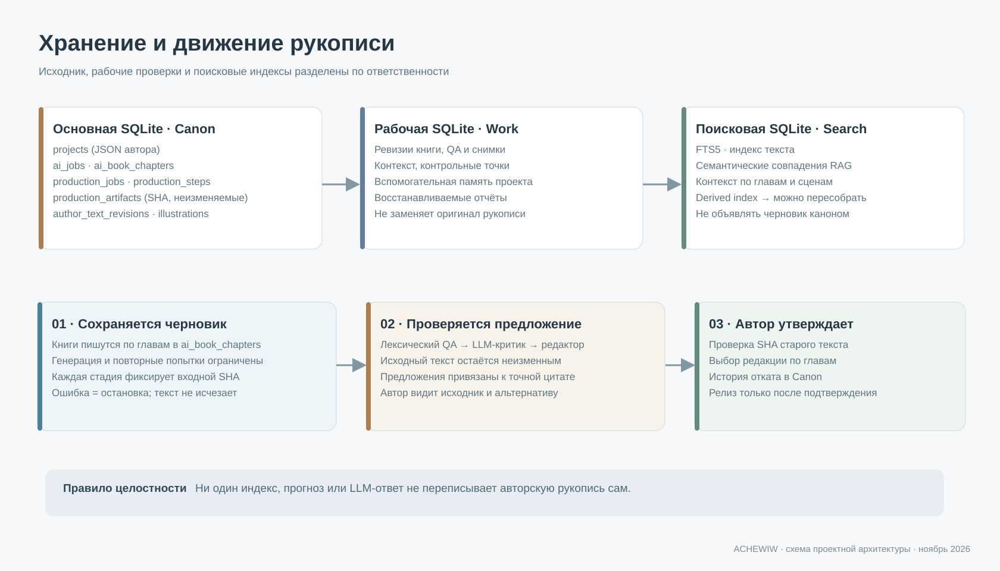
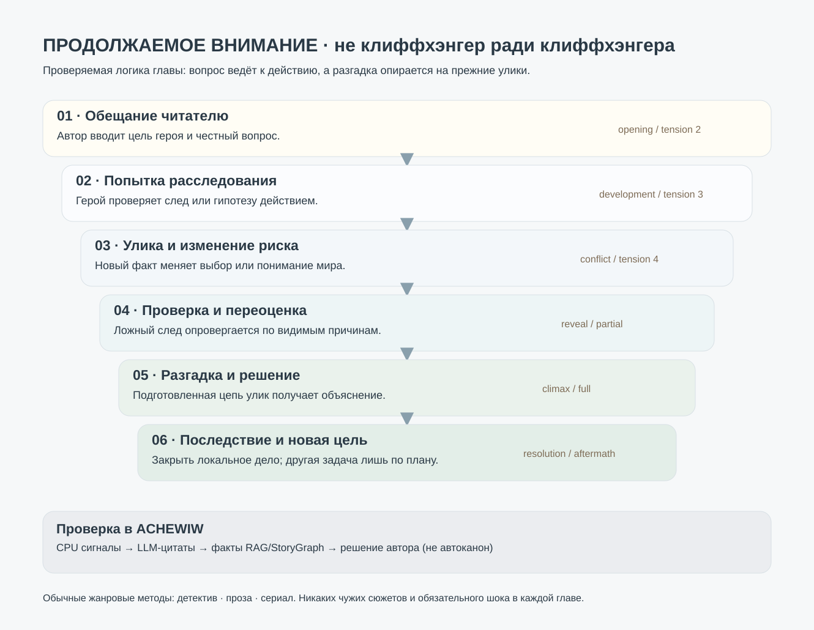
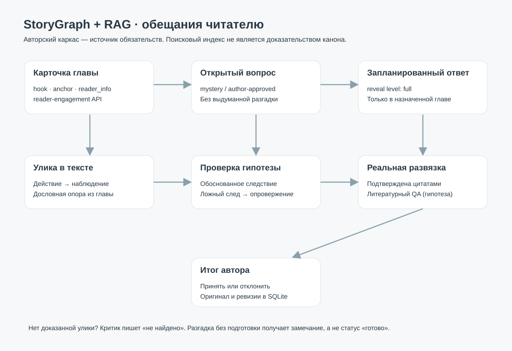

# ACHEWIW — Типография в кармане

### Закулисная мастерская рассказов, книг и выступлений

> **«Слово чтимое — чудо дивное».**  
> *A cherished word is a wondrous miracle.*

**ACHEWIW (StoryEngine)** — локальная издательская студия для автора: от идеи, плана и канона мира до редакторских проверок, иллюстраций и книги в **PDF, DOCX, EPUB и FB2**. Работает на собственном Linux-сервере с **Ollama, FastAPI, SQLite и, по желанию, ComfyUI/SDXL**. Рукопись не нужно отправлять в облачный сервис.

**Типография в кармане — закулисная мастерская рассказов, книг и выступлений. Локальная студия на Ollama: от идеи до PDF/DOCX/EPUB с редактурой, контролем авторских решений и подготовкой оформления по издательским стандартам.**

[](https://github.com/musikfed/achewiw/actions/workflows/achewiw-lifecycle-safety.yml)
[](app/main.py)
[](docs/CONVEYOR-RTX3060-RU.md)
[](docs/architecture/architecture-rtx3060.svg)



*Чистая стартовая страница. Это векторный демонстрационный макет, без личных проектов и тестовых повторов; реальные показатели сервера здесь не изображены.*

## Для чего это нужно

Здесь можно вести **роман, рассказ, фантастику, техническую книгу, нонфикшн или выступление**. Не одной кнопкой «напиши 300 страниц», а с раздельными, проверяемыми этапами:

1. **Замысел и каркас:** герои, цели сцен, причинность, интрига, ритм глав, ограничение перегрузки кадра.
2. **Генерация черновика:** главы пишутся постепенно; текст и прогресс хранятся в SQLite и не теряются от F5.
3. **Проверки:** поиск повторов на CPU, отдельный литературный критик, проверка связности и RAG-память.
4. **Редактор:** предлагает точные замены проблемных фрагментов, не переписывая рукопись без разрешения.
5. **Иллюстрации:** локальный ComfyUI/SDXL, обложка, рисунки и связь визуальных подсказок с сюжетными событиями.
6. **Типография и авторская приёмка:** пробный PDF/EPUB, сравнение редакций и выпуск после решения автора.

**Автор остаётся автором.** ACHEWIW ускоряет рутину структурирования, редактуры, иллюстрирования и вёрстки, но не заменяет творческий голос. Проверки ИИ могут ошибаться; черновик нужно читать и принимать осмысленно. Для серии учебных или технических книг возможности автоматизации полезны, однако высокая скорость не означает высокое качество.

## Посмотреть интерфейс

| Главная и пустая библиотека | Редактор рукописи |
|:--:|:--:|
|  |  |



*Все три иллюстрации — **демонстрационные макеты интерфейса**, а не выдуманные результаты работы GPU. Здесь нет имени реального автора и текста личной рукописи. Реальный браузерный вид зависит от выбранной вкладки и размера экрана.*

При запуске открывается **главная страница**, а не последняя книга. Книга выбирается из библиотеки отдельно; нажатие на логотип возвращает домой. Работа фоновой генерации не прекращается от перехода между вкладками.

## Локальный конвейер под RTX 3060, 12 ГБ

| Роль | Движок по умолчанию | Использование |
|---|---|---|
| Писатель | `qwen3:8b` через Ollama | Создаёт черновики глав |
| CPU-контролёр | Python / SQLite | Ищет точные повторы и разрывы |
| Литературный критик | `qwen3:4b-instruct` через Ollama | Проверяет **все** окна глав |
| Редактор | Та же модель 4B, следующая роль | Предлагает точечные правки |
| Художник | ComfyUI + локальный SDXL | Обложка / иллюстрации по выбору |
| Верстальщик | Python / CPU | Пробный PDF A5 / EPUB |
| Автор | Человек | Решает, какие редакции принять |
| Архивариус | Python / SQLite | Итоговые файлы, снимок и локальный корпус |

Модели загружаются **последовательно**, а не все сразу. Между GPU-ролями конвейер сверяется с `Ollama /api/ps`, продлевает аренду GPU и выгружает только разрешённые автором модели. Посторонние модели других приложений **не останавливаются**. `qwen3:8b` и `qwen3:4b-instruct` — практичная начальная конфигурация для 12 ГБ; фактическое потребление VRAM зависит от квантования и контекста. ComfyUI и SDXL требуют отдельной проверки свободной памяти на хосте.



**Без скрытых установок:** переключение ролей не скачивает модели. Выбор — среди уже установленных в Ollama. [Как подготовить, проверить и обновить конвейер](docs/CONVEYOR-RTX3060-RU.md).

## Как устроено хранение

ACHEWIW не использует облачную базу. Состояние имеет три слоя SQLite:

- `data/achewiw.sqlite3` — авторские проекты, главы, черновики, работа конвейера, решения и история изменений.
- `data/work.sqlite3` — редакторские снимки, вспомогательные проверки и рабочее состояние.
- `data/search.sqlite3` — поисковый индекс для RAG; восстанавливаемые данные.





RAG и StoryGraph помогают не забывать события и авторские факты, но **не гарантируют**, что литературная логика автоматически станет безупречной. Уже записанный черновик нельзя считать каноном только потому, что он попал в поисковый индекс.

## Первый запуск и обновление

Проект рассчитан на **свой Ubuntu-хост**, доступ в студию — из доверенной локальной сети / через VPN. Не открывайте порт 7080 напрямую в публичный интернет без отдельной защищённой конфигурации.

```bash
git clone https://github.com/musikfed/achewiw.git
cd achewiw
cp .env.example .env
# Настройте доступ и локальные пути согласно инструкции установки.
```

На действующем сервере с уже сохранённой библиотекой используйте **только безопасное обновление без очистки БД**:

```bash
cd /1tbdisk/achewiw
git status --short
git fetch --no-tags origin
git switch main
bash scripts/update-studio-clean.sh preview
# Только если диагностика не обнаружила активных заданий:
bash scripts/update-studio-clean.sh apply
bash scripts/achewiw-control.sh status
```

Если Git обнаружит локальные изменения или расхождение истории, не используйте `reset --hard` или `git clean`: сначала сохраните свои правки. [Подробности обновления](docs/CONVEYOR-RTX3060-RU.md), [безопасный lifecycle](docs/ACHEWIW-CONTROL-RU.md).

## PDF, DOCX, EPUB и ГОСТ: что поддерживается

- **EPUB и FB2** — читаемые электронные книги.
- **DOCX** — редактируемый издательский документ.
- **PDF A5** — рабочая читательская и печатная проба.
- **Выходные сведения** — автор, год, заголовок, редакция, по наличию метаданных.

Для оформления выходных сведений ориентиром служит **ГОСТ Р 7.0.4-2020**; библиографическое описание — отдельная задача. Важное ограничение: **ACHEWIW пока не подтверждён как издательская система, полностью соответствующая ГОСТ, и не создаёт сертифицированный PDF/X**. Для типографии дополнительно проверяют размеры блока, вылеты, шрифты, цветовой профиль, права на иллюстрации и требования конкретной печатной машины. [Модель Release Gate](docs/ARCHITECTURE-v4-RELEASE-GATE-TECHNICAL.md) пока экспериментальная, юридическая и антиплагиатная проверка не выдаётся за автоматически готовую.

## Что проверено, а что пока эксперимент

**Реализовано:** локальный веб-интерфейс, сохранение книг в SQLite, восстановление генерации после F5, экспорт, локальные модели, базовые проверки текста, версии и предложения редактора, конвейер с ролями и авторским утверждением. **В CI:** синтаксис, API и SQLite-инварианты, защита авторского текста, последовательный GPU-lock. **Требует испытаний на настоящем CORE:** комфортная скорость больших моделей и SDXL, литературное качество полного романа, стойкость на 20 000 слов и полная предпечатная сертификация.

## Документация и участие

- [Руководство: собрать книгу с иллюстрациями](docs/USER-GUIDE-BOOK-EDITION-RU.md)
- [Архитектура конвейера RTX 3060 и последовательных моделей](docs/CONVEYOR-RTX3060-RU.md)
- [RAG и сохранение длинной генерации](docs/BOOK-HYBRID-RAG-CONTINUATION-RU.md)
- [Версии, QA и визуальные загадки](docs/EDITORIAL-VERSIONS-VISUAL-PUZZLES-RU.md)
- [Идеи, найденные ошибки и предложения — GitHub Issues](https://github.com/musikfed/achewiw/issues)
- [GitHub SEO: описание, темы, карточка и публикация релизов](docs/GITHUB-DISCOVERABILITY-RU.md)
- [Порядок безопасной очистки старых веток](docs/BRANCH-CLEANUP-RU.md)

**English:** ACHEWIW is a **self-hosted, local AI writing and book-production studio** using Ollama, FastAPI, SQLite and optional ComfyUI. It helps plan novels, technical books and speeches, review manuscripts, preserve author decisions, generate book artwork, and export PDF, DOCX, EPUB and FB2. One GPU role at a time; author approval before publication. It does not promise automatic literary excellence or PDF/X certification.

**Поисковые направления:** локальный ИИ для писателей, генератор книг Ollama, издательский конвейер, редактор романов, локальная типография, книга в EPUB, Python FastAPI SQLite, RAG и граф сюжета, RTX 3060, ComfyUI. 

---

**Автор остаётся автором. Читатель должен получить хорошую книгу, а не отчёт об отработанных токенах.**

## Воронка внимания, расследование и заслуженная развязка

Помимо генерации глав в ACHEWIW появился отдельный **контракт читательских ожиданий**: крючок и вопрос → конкретное действие → улика → проверка гипотезы → рост ставки → разгадка с доказательствами → последствия. Для детективов, литературной прозы и сериального повествования используются разные правила; модель **не копирует сюжеты известных книг и сериалов** и не создаёт тайну, которой нет в каркасе автора.

- В разделе **02 · Story.prj** открывается карта внимания по главам, связанная с авторским сюжетом, настройками напряжения (0–5) и уровнем раскрытия: `none`, `hint`, `partial`, `full`, `aftermath`.
- При каждом продолжении художественной главы Ollama получает конкретную задачу следующего фрагмента. Абстрактные реплики и искусственные клиффхэнгеры не считаются развитием сюжета.
- **CPU-проверка и независимый LLM-критик** ищут повторяющиеся вопросы, шаблонные концовки, реальное событие, улику и доказательство разгадки. Если такого доказательства нет, критик обязан написать «не найдено».
- План, опубликованные факты и черновики хранятся отдельно; предложения редактора не переписывают рукопись без авторского подтверждения.





[Подробно: интрига, расследование, визуальные загадки, сериальные и литературные приёмы](docs/READER-RETENTION-MYSTERY-RU.md). Это проверяемый **план и редакторские подсказки**, а не гарантия, что маленькая LLM напишет захватывающий роман без работы автора.

## Поиск в Google, Яндексе и тематических каталогах

Для открытого GitHub-репозитория подготовлена [отдельная публичная страница в `docs/index.html`](docs/index.html) с читабельным текстом, SEO-заголовком, описанием, Open Graph и разметкой `SoftwareSourceCode`; она отделена от локальной студии и не содержит рукописей. **GitHub Pages уже включён владельцем** для `main /docs`; адрес проекта — `https://musikfed.github.io/achewiw/`. Важное уточнение: наличие Pages подтверждено настройками репозитория, фактическую выдачу HTTP 200 и индексацию ещё нужно проверить. `About` и Topics репозитория пока не заполнены.

Для продвижения нужно вручную указать GitHub About/Topics, проверить опубликованную страницу, подтвердить права в Google Search Console и Яндекс Вебмастере и публиковать воспроизводимые примеры работы. [Подробная инструкция для Google и Яндекса](docs/GITHUB-DISCOVERABILITY-RU.md).

Индексирование не гарантируется: полезные реальные кейсы, качество объяснения и внешние ссылки значат больше, чем повторение ключевых слов.

**Сайт лаборатории:** для публичного `https://peginelab.ru/` подготовлены отдельная страница `/achewiw/` и карточка проекта со ссылкой на этот репозиторий. Они находятся в `musikfed/peginelab` (`main`); фактическая публикация на домене зависит от безопасного CI/CD-развёртывания PegiNelab.
