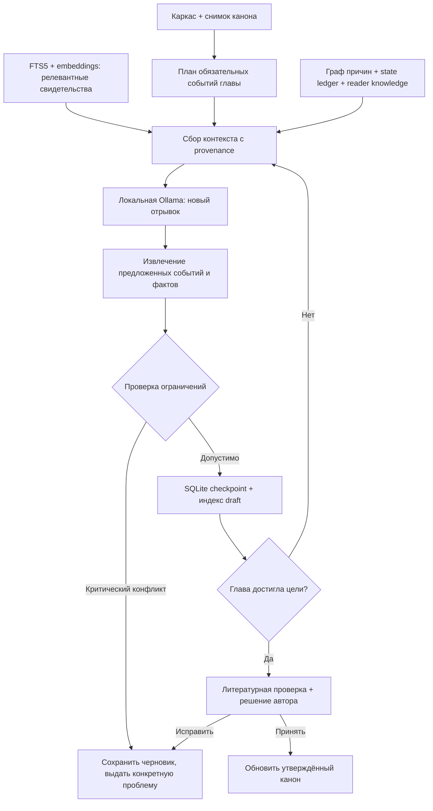

# ADR-0003 — Одна SQLite, специализированная модель литературного мира

**Статус:** принято как архитектурное решение; таблицы и функции ниже — **целевой контракт**, не заявление об их готовой реализации.  
**Проект:** ACHEWIW StoryEngine.  
**Дата:** 2026-11-05.  
**Входные данные:** генерация «Филиниусы» прервана на 1 266/20 000 слов из-за повтора; текущая Studio использует SQLite, `story_nodes`, `story_edges`, `story_chunks` и FTS5.

## Решение

**Не менять базовую СУБД. Не вводить Neo4j, PostgreSQL или отдельный векторный сервер.** На текущем однопользовательском сервере одна SQLite поддерживает хранение каркаса, графа, индекса прозы, авторского канона и редакторских решений в одной транзакционной границе. Реализация сложной логики нужна в **моделях, ограничениях, SQL-запросах и редакторском пайплайне**, а не в новом сервере БД.

SQLite не поддерживает PostgreSQL-подобные именованные схемы в одном файле. Поэтому логические подсистемы различаем **префиксами таблиц** (`story_`, `editorial_`, `ai_`) и обязательными полями `project_id`, `branch_id`, `canon_revision`, а не выдуманными `schema.` внутри файла. Используем `CREATE TABLE IF NOT EXISTS` + отдельную явную версионированную миграцию, позже — rebuild индексов из первичных источников.

## Чем отличаются источники данных

| Источник | Первичный или производный? | Может самостоятельно менять канон? |
|---|---|---|
| Каркас, авторские тексты, утверждённые факты | **Первичный** | Только автор |
| Авторская версия фактов, состояния, причинный граф | **Первичный** после утверждения | Только автор |
| Сгенерированный текст, найденные моделью факты, гипотезы QA | Кандидат | **Нет** |
| FTS5, векторные embeddings, выбранные цитаты | **Производный индекс**, пересоздаётся | **Нет** |
| Таблицы оценки качества, предупреждения | Производный результат проверки | **Нет** |

## Требуемые таблицы следующего этапа

Все записи изолированы по `(project_id, branch_id)`; ссылки на сцены/узлы должны проверяться на принадлежность тому же проекту/ветке; основная ветка — `main`.

1. **`story_world_events`** — стабильный `event_id`, `scene_id`, мировой порядок `world_seq`, порядок подачи читателю `discourse_seq`, точка зрения, дата/место, статус авторского утверждения, `canon_revision`. Мировая хронология и литературная подача **различаются** (важно для флешбэков).
2. **`story_entity_states`** — `entity_id`, `event_id`, `attribute`, `value_before`, `value_after`, единицы/границы, источник и статус. Это журнал изменений: у кота нельзя одновременно быть в Москве и на корабле, если не задан переход, иллюзия или двоение.
3. **`story_knowledge_ledger`** — `fact_id`, `knower_id` (персонаж либо специальный `reader`), `event_id`, `knowledge_level` (`unknown|suspects|knows|believes_false`), `discourse_seq`. **Знание персонажа и читателя — разное**. Ложное убеждение не обязано противоречить действительному миру.
4. **`story_plot_threads`** + **`story_thread_beats`** — линия интриги; `setup`, `clue`, `complication`, `reveal`, `payoff`, обязательность закрытия, глава запланированного раскрытия, связь с `fact_id`. Не все загадки должны быть закрыты — незавершённость должна быть авторским решением.
5. **`story_fact_evidence`** — точные `scene_id`, `chunk_id`, версия текста/хеш, диапазон доказательства, кто утверждал и когда. Парафраз LLM не заменяет проверяемую цитату/место текста.
6. **`story_editorial_proposals`** — предлагаемые ИИ факты, ребра и исправления, `status=pending|accepted|rejected`, ссылки на доказательства и модель. Никакого тихого утверждения AI-догадок.
7. **`story_editorial_findings`** — `kind`, `severity`, `confidence`, `scene_id`, `fact_ids`, подтверждающие `evidence_ids`, версия канона, решение автора. Вывод языковой модели — **гипотеза**, не доказанная ошибка.
8. **`story_canon_revisions`** — неизменяемая запись версии канона, хеш, родительская версия, ветка, метки принятия. Новые черновики получают снимок канона; при конфликте версий — пересмотр, а не молчаливое применение.
9. **`story_chunk_embeddings`** (позже) — `chunk_id`, `model_id`, `dimension`, `vector_blob`, `text_hash`. Кэш можно стереть и перестроить без потери рукописей. Для малой коллекции можно считать cosine similarity локально по сохранённым векторам без векторного сервера.

Следует расширять текущие `story_nodes`/`story_edges`, а **не параллельно создавать второй несовместимый граф**. Граф отображает мир событий и связи. Отдельные таблицы состояния, знания и интриг связываются со стабильными `fact_id`/`event_id`.

## Контракт выполнения одной главы

**Критические инварианты** (проверяются кодом, не одной LLM): причина не позже следствия **в мире**, предмет введён до использования, у персонажа нет необъяснимого перехода состояния, раскрытие факта не превышает допустимый `discourse_seq`, черновик не становится каноном без решения автора, ветка не видит изменения других ветвей после fork, версия скомпилированного контекста совпадает со снимком канона.

**Литературные гипотезы** (не выдавать за гарантии): провисание внимания, клише, недостоверная мотивация, скучный диалог, чрезмерная симметрия глав, повторы образов и нелепый поворот. Нужен LLM-критик и объяснимые доказательства. Никакая СУБД сама не оценивает художественность.

## Порядок внедрения, чтобы не потерять 1 266 слов

1. **Schema v1:** нормализованные таблицы состояния, знаний и интриг; миграции только добавляют структуры. Тесты реальной старой SQLite на копии. Никакого `DROP TABLE`, wipe или автоматической переделки текста.
2. **Extract → verify → propose:** локальная Ollama извлекает кандидатов `fact/event/state/knowledge/beat` из порции текста; deterministic validation; автор утверждает либо отклоняет. Ссылки — на точные источники.
3. **Read-only continuity report:** показать по главам хронологию, состояния, факты, открытые вопросы, сюжетные нити, конфликты с точным местом в тексте; отделить ошибки уровня «доказано» от модельных гипотез.
4. **Generation gate:** перед следующим отрывком применять проверенный пакет данных и список разрешённых новых событий. При обнаруженном конфликте — максимум ограниченные попытки исправления. **Не начинать заново** и не затирать сохранённую главу.
5. **Hybrid retrieval:** FTS5 + `nomic-embed-text` через хостовую Ollama, модель эмбеддингов только для индексирования по явной кнопке и с мониторингом VRAM; при отсутствии индекса — fallback на FTS5, никогда не подменять граф.
6. **Branches:** неизменяемая общая предыстория до `fork_scene_id`, отдельный мир после неё, собственные состояния/читательское знание/факты. Генерация альтернативного текста только после проверки наследования.
7. **QA на реальном романе:** кейсы из «Филиниусы» на 20 000 слов, восстановление после остановки, тест на чужую книгу/ветку, задержанную разгадку, временной флешбэк, ложное убеждение и изменение рукописи после принятия.

## Почему не несколько СУБД

Если обновить факт в SQLite, граф в Neo4j и embedding в Qdrant, каждый компонент может увидеть **разную версию сюжета**. Межбазовые транзакции, повторные события, outbox, reindex/reconciliation, резервирование и восстановление усложнят Studio. При текущем объёме и числе пользователей это неоправданно. Производные индексы должны пересобираться по первичному журналу.

**Условия пересмотра решения:** реальная конкуренция независимых авторов/редакторов, доказанные ограничения SQLite на фактической нагрузке, большое число параллельных записей или многомиллионные векторные индексы. Тогда первый кандидат — **один PostgreSQL + pgvector**, с теми же стабильными `fact_id` и API-контрактом; не распределённый зоопарк.

## На что сейчас нельзя полагаться

Текущий `story_memory.py` уже хранит граф и FTS5, но **не** реализует автоматически все таблицы этого ADR и полноценный Extract/Verify/Propose/QA. До появления этих слоёв нельзя обещать литературную или логическую безошибочность. Сохранять действующую SQLite и черновики, а не проводить срочную миграцию.
