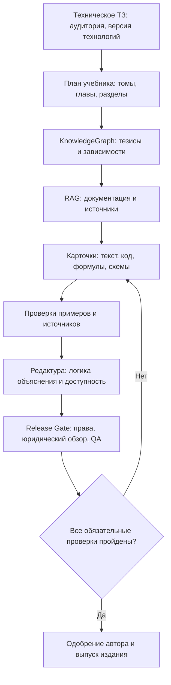

# RFC-0004 — Release Gate и техническая литература

**Проект:** ACHEWIW — «Закулисная мастерская рассказов, книг и выступлений»

**Статус:** архитектура, не внедрено в веб-интерфейс, не является автоматической юридической экспертизой. Docker/Ollama и сервер не менять.

## Решение

Перед каждым *окончательным выпуском* в выбранном `PublicationProfile` существует проверка `ReleaseGate`. Невозможно принять неподписанный или устаревший отчет за разрешение к публикации. Проверки по профилям (художественное произведение, техническая книга, журнал, рекламный флаер, мерч) отличаются.

Это не мешает автору выполнять **черновую** верстку и экспортировать proof для просмотра до проверок. Gate блокирует только `release.finalize` (публикационный manifest), а не творческий процесс.

## 1. Release Gate: матрица независимых проверок

| Проверка | Художественное произведение | Техническая литература | Результат |
|---|---|---|---|
| `canon_consistency` | Timeline, персонажи, причинность, неснятые противоречия | Логика утверждений и противоречия между главами | ID нарушений и карточек |
| `citations_rights` | Права на цитаты, перевод, обложку, изображения, шрифты | Лицензии кода, схем, таблиц и изображениям, разрешения на использование источников | Источник, лицензия, scope, правообладатель |
| `similarity_triage` | Совпадения с доступным корпусом | Сходство, корректность цитирования, тексты лицензий, общепринятые определения | Найденные фрагменты с URL/ID и обоснованием |
| `jurisdiction_review` | Применимые ограничения распространения, возрастная маркировка, специальные правила рекламы и пропаганды | Те же требования, дополнительно отраслевые ограничения, если применимы | Юрисдикция, аудитория, редакция закона и квалифицированный reviewer |
| `safety_accuracy` | Добросовестность маркировки и фактчекинга, если текст документальный | Проверка технических рекомендаций, безопасность процедур, актуальность версий | Тесты, спецификации, предупреждения |
| `technical_verification` | Не обязательно | Воспроизводимость команд/расчетов, схем, единиц, API-контрактов и ссылок | Акт испытаний или явно отмеченные непротестированные примеры |
| `accessibility` | Читательские форматы: структура, alt, навигация | То же + формулы, таблицы, легенды диаграмм | Отчеты EPUB/accessible PDF и ручной обзор |
| `print_preflight` | Печатные профили PDF/X, bleed, шрифты, профили | То же + векторная читабельность схем и мелких обозначений | Отчет preflight |

На конкретном `PublicationProfile` обязательные проверки предопределены; запрос на выпуск невозможен, если хотя бы одна обязательная проверка не `passed` или `reviewed` в соответствии с политикой **и** нет подписи уполномоченного reviewer. Не допускать «пустое OK» от ИИ. `unknown`, `pending`, `blocked`, `failed`, `stale` — не проходной статус.

Параметры проверки:
- `target_countries[]`, `language`, `audience`, `publication_type`, `medium`, `edition_id`, `manuscript_hash`, `assets_hash`, `policy_version`.
- `evidence_refs[]`, `reviewer`, `checked_at`, `decision_note`, `finding_ids[]`, `human_confirmed`.
- Сохранить таймштамп и исходную нормативную ссылку; не объявлять универсально законными издания для всех стран.

**Нельзя приравнивать любое спорное мнение к запрещённой пропаганде.** Законы и определения отличаются между странами. Автофильтр лишь отмечает потенциальные вопросы для человеческой, при необходимости юридической экспертизы. Сохранять возможность обжаловать ложное срабатывание; сохранять документы экспертизы и прозрачную причину решения.

### Отсутствует «разрешённый процент плагиата»

**Не устанавливать единый процент «разрешённого плагиата».** `similarity_score` — это совпадение с теми текстами, к которым у инструмента есть доступ; не юридическая или этическая квалификация. Сравнивать с учётом цитирования, лицензий, технических шаблонов и стандартных оборотов. Автопорог, например 15%, может служить **только сигналом для дальнейшего анализа**, а не предрешать нарушение и не выдавать автоматическое разрешение.

- Нужен локальный анализ внутренних произведений, источников и явно подключённых открытых корпусов; нельзя обещать полный поиск по закрытым базам.
- Сохранить `match_refs[]`, `quoted?`, `licensed?`, `bibliography?`, `false_positive?`, `review_note`.
- Даже небольшой фрагмент может быть качественно значимым; даже высокий уровень совпадений может быть корректной цитатой/библиографией.
- Для кода — учитывать лицензии, совместимость и атрибуцию отдельно от текстового сходства.
- Для AI-изображений и шрифтов — происхождение, условия использования, права на референсы.

Источники:
- U.S. Copyright Office: https://copyright.gov/help/faq/faq-fairuse.html — нет универсального законного процента.
- Turnitin: https://helpcenter.turnitin.com/hc/en-us/articles/27811925295501-Does-Turnitin-check-for-plagiarism-and-what-is-a-good-Similarity-score — similarity ≠ plagiarism.
- Право в целевой стране требует проверки уполномоченным специалистом.

## 2. Режим TechnicalBook

Художественная фабула и техническая доказательная база — **разные типы канона**. Для фантастики канон фиксирует вымышленные факты мира; для технической книги `KnowledgeGraph` фиксирует проверенные утверждения, источники и воспроизводимые эксперименты. Версия утверждения может устареть при изменении ПО или стандарта, поэтому старую версию не стирают, а создают новую, с зависимостями и errata.

`Work(kind=fiction|technical|hybrid)`. Структура сохраняется: том → глава → раздел/сцена → абзац; технические карточки добавляют `Heading`, `Concept`, `Claim`, `Source`, `Procedure`, `CodeExample`, `Equation`, `Diagram`, `Table`, `TestResult`, `GlossaryEntry`, `Exercise`, `Answer`, `RevisionNote`.

### Технические утверждения и источник истины

`TechnicalClaim`: `claim_id`, `statement`, `valid_for` (версии ПО, платформы, стандарта), `confidence`, `verified_at`, `evidence_ids[]`, `affected_cards[]`, `status=proposed|verified|disputed|outdated`.

`Evidence`: `source_id`, `type=standard|vendor_docs|primary_paper|experiment|test|author_note`, `title`, `url|repo_commit|file_hash`, `retrieved_at`, `license`, `quote_location`, `reliability_note`.

RAG ищет связанные источники и точные версии, но не утверждает «факт» без цепочки `claim -> evidence -> source`. Варианты для разных читателей (новичок, практик, специалист) делаются поверх одного доказанного ядра; допускается изменение учебного порядка, глубины и примеров, **без выдумывания результатов тестов**.

### Source-first diagram pipeline

`DiagramCard`: `diagram_id`, `card_id`, `diagram_type`, `source_format=mermaid|dot|plantuml|svg|tikz`, `source_text`, `references_claim_ids[]`, `caption`, `alt_text`, `renderer_version`, `asset_sha256`, `status=proposal|accepted`.

Схемы: архитектура сервиса, сетевые топологии, UML, последовательности, схемы данных, блок-схемы алгоритмов, зависимость систем, BI-пайплайны, электронные/структурные схемы — **профессиональные электрические CAD-схемы нельзя считать проверенными по факту красивой картинки**. Для них экспорт в KiCad/другой профиль с проверкой электрических правил, номиналов и pinout как отдельный специализированный модуль.

- Mermaid/Graphviz исходник хранится рядом с карточкой, renderer выводит SVG. Векторный SVG сохраняет читаемость при масштабировании, но нужен контроль минимального размера подписей при печати.
- Математика: LaTeX/MathML исходник + печатная и доступная семантическая версия; единицы измерения нормализованы, проверки размерностей.
- Код: язык, версия runtime, команды установки, зависимости, тестовый результат, воспроизводимое окружение. Запуск недоверенных примеров **только в отдельной изолированной среде** с отказом от доступа к хостовым файлам/GPU/сети по умолчанию.
- Диаграммы и листинги не редактируются пиксельно без изменения исходников; проверяется, что экспорт отрендерен из последней одобренной версии.
- Любая схема, измененная техническим утверждением, становится `stale` в ProductionGraph и требует проверки.
- Alt-текст и подписи должны объяснять смысл схемы, а не перечислять внешние формы.

### Workflow учебника

Итоговые материалы: исходники Markdown/HTML/LaTeX, EPUB 3.3, PDF для чтения, **доступный** PDF (при соответствии верифицированному PDF/UA-профилю), PDF/X для типографии, SVG diagrams, Git repo примеров, требования к запуску, глоссарий, список литературы, errata. PDF/UA и PDF/X решают **разные** задачи; не предполагать, что PDF/X автоматически доступный.

Ссылки:
- https://www.w3.org/TR/epub-33/
- https://pdfa.org/resource/iso-14289-pdfua/
- https://graphviz.org/docs/outputs/svg/
- https://mermaid.js.org/intro/

## 3. Чего система не должна обещать

- «100% отсутствие плагиата» — невозможно проверить закрытые источники без доступа.
- «Законно во всём мире» — невозможно без целевой юрисдикции и конкретного правового обзора.
- «ИИ проверил техническую книгу и всё правда» — генерация не равна верификации.
- «Любая схема пригодна для производства» — специализированные CAD/EDA требуют дополнительной инженерной проверки.
- «Любой PDF готов любой типографии» — printer profile, цвет, корешок, proof и соответствие требованиям заказа.
- «Любой текстовый анализ спорного высказывания = запрет» — нужен контекст, фактическое право и человеческое решение.

## 4. Priority milestones

1. **P0:** структура карточек, ревизии, сохранение канона/KnowledgeGraph, принятие автором изменений.
2. **P1:** работающий release gate: задания по check-типам, snapshots, approval, audit trail, блокирующий только финализацию.
3. **P2:** технические карточки `Claim/Source/Diagram/CodeExample`, RAG и векторные схемы.
4. **P3:** воспроизводимые code/equation checks и render integration; редакторская QA.
5. **P4:** PDF/X + EPUB + доступный PDF, QA-preflight, package for editor/publisher.
6. **P5:** профессиональная продукция, маркетинг, пасхалки и жанровые вариации.

**Текущее состояние:** документ/экспериментальное ядро только в GitHub; выпуск и проверки закона/оригинальности пока не выполняются автоматически.
