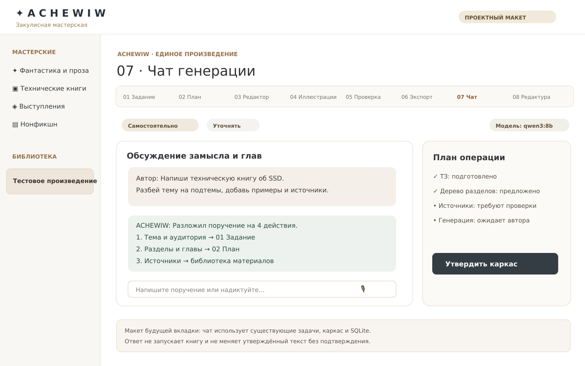
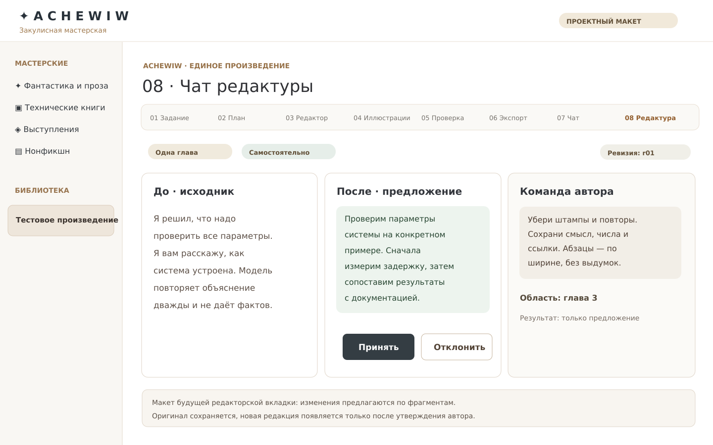
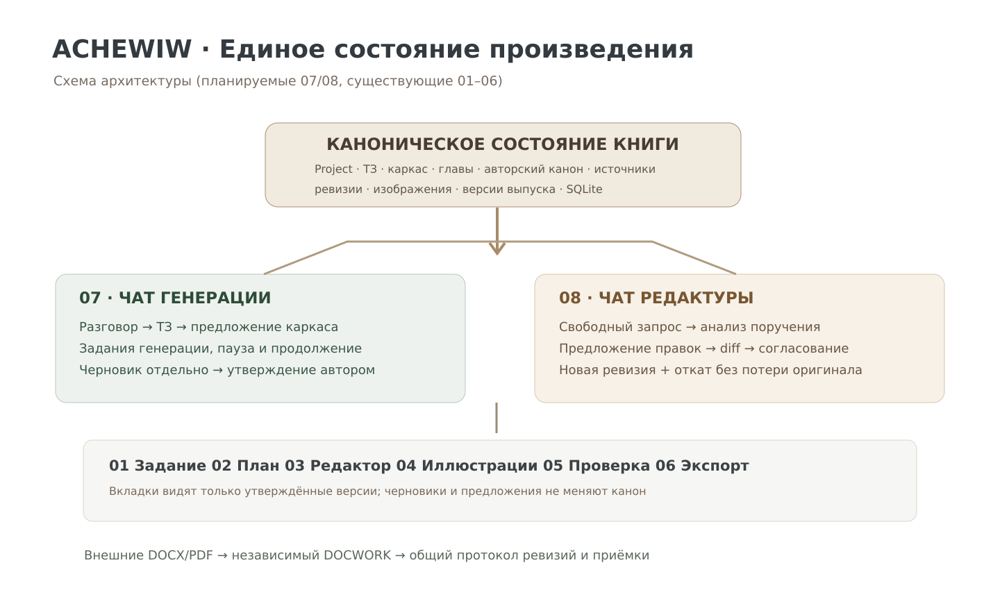
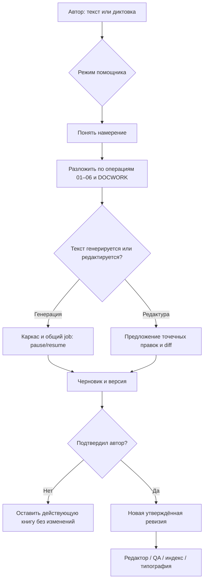

# ACHEWIW · Чатовые мастерские: схема работы и инструкция

**Статус: проектируемый интерфейс · 25 ноября 2026.** Эта инструкция описывает **предполагаемое поведение**, а не утверждает, что вкладки 07/08 уже внедрены. Шесть существующих мастерских сохраняются. Книга/рукопись, ревизии и утверждения остаются общими.

## 1. Как будет выглядеть

### 07 · Чат генерации — концептуальный макет

*Макет, созданный для проектирования UI. Отображает принцип: автор пишет или диктует задачу, помощник разбирает её по мастерским, предлагает план и не запускает незапрошенную генерацию.*

### 08 · Чат редактуры — концептуальный макет

*Макет, не рабочий скриншот. Оригинал слева, предлагаемая правка по центру, команда справа; согласование до сохранения новой редакции.*

### Общая схема книги и мастерских

## 2. Как автор будет работать с созданием книги

1. В **07 · Чат генерации** выбрать «Помощник · уточнять» или «Самостоятельно · разложить и предложить».
2. Написать или надиктовать свободное поручение, например: «Хочу научно-популярную книгу про HDD для инженеров; разложи на подтемы, сделай наглядные примеры».
3. Помощник определяет жанр, тему, аудиторию, цель, объём (если не задан — предложенный объём помечается предположением) и раскладывает значения по **01 · Задание**.
4. Предлагает **02 · План**: главы, подтемы, логическую последовательность; автор утверждает каркас, либо меняет его.
5. Только после подтверждения запускается существующая система генерации. Чат показывает status/job и работает с **тем же** сохранённым текстом, pause/resume и RAG/Graph.
6. Автор может написать «Третья глава повторяется, остановись после фрагмента и уточни действие» — помощник связывает запрос с текущим job, не создавая вторую параллельную книгу.
7. Готовый черновик **не** автоматически становится принятой рукописью; он проходит предварительное чтение, QA и авторскую приёмку.

Если параметр критически необходим для осмысленной работы, режим «Помощник» задаёт **один прицельный вопрос**, не анкету. Самостоятельный режим без лишних вопросов формирует предложения с отмеченными допущениями.

## 3. Как автор будет редактировать готовую книгу

1. Открыть собственную книгу в Studio **или** импортировать принадлежащую автору внешнюю DOCX/PDF в независимый **DOCWORK** (без предварительной генерации).
2. В **08 · Чат редактуры** выбрать область: выделенный абзац, глава, несколько глав, книга.
3. Ввести или надиктовать поручение, например:
   > «Примени мой стиль изложения, убери “я решил”, “я так подумал”, “я вам расскажу”, исправь смысловые повторы. Сохрани числа, источники и технический смысл. Абзацы выровняй по ширине, библиографию оформи отдельно; изображения — в сдержанном журнальном стиле».
4. Помощник разбивает поручение по исполнителям: **литературная правка** (LLM, только предложение), **типографика** (детерминированные стили), **источники и библиография** (без выдуманных DOI), **иллюстрации** (отдельные исходники, новая версия по согласованию).
5. Показывается **до/после** с местом правки, номером главы, контролем исходной версии и объяснением. Принятие — по фрагменту или по отдельным этапам.
6. После подтверждения создаётся новая редакция; оригинал не перезаписывается. **03 · Редактор** видит утверждённый текст, **05 · Проверка** помечает прежний анализ устаревшим, а **06 · Типография** использует конкретную утверждённую ревизию.
7. Если предложение не понравилось, нажать «Отклонить»; можно повторно попросить иной вариант, не создавая ненужной пере-генерации всей книги.

Это **не** одна огромная LLM-команда на целую книгу: длинные документы разбиваются по главам/фрагментам с чекпойнтами и ограничением контекста.

## 4. Два способа общения в обеих вкладках

| Режим | Что делает | Когда спрашивает |
|---|---|---|
| **Помощник · уточнять** | Уточняет намерение и самостоятельно раскладывает известные сведения по существующим полям | Только если не хватает критически важного параметра для следующего шага |
| **Самостоятельно · разложить и предложить** | Без лишних вопросов строит план, выбирает безопасные значения по умолчанию и готовит предложения | Перед необратимыми действиями и заменой утверждённых материалов |

Переключение не стирает беседу, ТЗ, каркас, текст или историю редакций. Неразрешённые предположения видимы.

## 5. Общие данные, события и контроль

**Необходимо соблюдать:** источник правды один; предложения не канон; утверждение атомарно; у каждого выпуска конкретная версия; устаревшее предложение не переписывает текст; DOCWORK работает без зависимости от генератора.

## 6. Проверки перед внедрением

| Проверка | Ожидаемый результат |
|---|---|
| Редактура 1 главы | Модель предложила точечную правку; diff понятен; автор принял; исходник восстановим |
| Диалоговые режимы | Сохранилась история при смене «Уточнять» ↔ «Самостоятельно» |
| Связь мастерских | После приёмки редактор и экспорт видят новую ревизию, QA помечен для перепроверки |
| Внешняя рукопись | DOCWORK импортирует собственный DOCX/PDF и предлагает правки независимо от Studio |
| Длинная книга | Нет отправки всего содержания в один контекст Ollama; есть контрольные точки |
| Сохранность | 7080, 17080, Ollama, чужие проекты и файлы не повреждены |

## 7. На каком этапе внедрение

Это **дополнение к уже работающему книжному конвейеру, а не отдельное приложение**. Реальная проверка книги «тестовый проект» прошла генерацию 5 глав, паузу, вмешательство автора, принятие и PDF. Но качество прозы и интеллектуальная редактура пока являются недостаточно решёнными проблемами.

Следующая реализация должна быть небольшой и проверяемой: **«08 · Чат редактуры» → одна сохранённая глава → точечные предложения → diff → утверждение → новая редакция**. Далее — внешняя книга в DOCWORK, затем управление генерацией из чата. Не разворачивать макеты как будто работающие формы; нельзя считать их реализацию доказанной.
