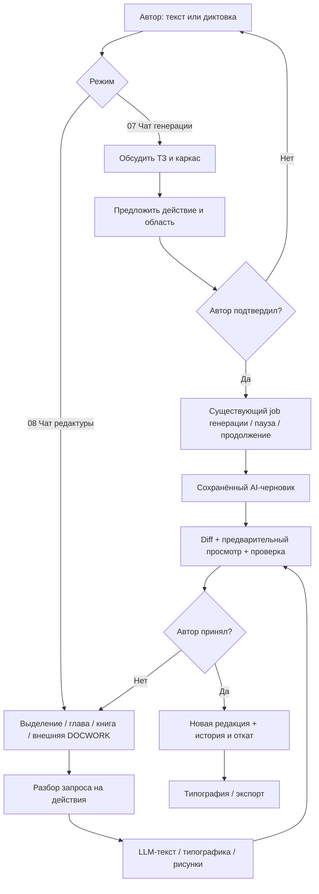

# ACHEWIW — диалоговая генерация и диалоговая редактура книги

**25 ноября 2026 · активное расширение основного издательского конвейера (P0/P1), не отдельный проект.**

> Статус: **утверждаемая продуктовая спецификация / запланировано**. Этот документ не означает, что режимы уже работают или развёрнуты. Нельзя смешивать документирование с реализацией.

## Замысел

Добавить **две дополнительные вкладки** для управления книгой естественным языком и голосом. **Не заменять** существующие шесть этапов «Задание → План → Редактор → Иллюстрации → Проверка → Типография / Экспорт». Наоборот, диалоговые режимы должны использовать те же проекты, каркас, авторский канон, базу SQLite, сохранённый текст и контроль версий.

### 07 · Чат генерации (создать / развить книгу по запросу)

Автор описывает задачу обычной фразой или диктует: «Напиши техническую главу об архитектуре HDD с примерами», «Предложи три структуры рассказа», «Сделай действие в третьей главе конкретнее», «Продолжи с сохранённого места, но не повторяй диалог».

Логика: **сообщение автора → понимание намерения → предложение действия и затрагиваемого раздела → подтверждение → задание в существующем генераторе → сохранение результата как черновика → авторская приёмка**.

- Сохранять диалог **по project_id**, с привязкой к главе/сцене, плану, заданию и конкретной редакции; автор может выбрать уровень: книга, глава, фрагмент.
- Если книга ещё не создана, чат может помочь сформировать ТЗ и **предложить** каркас, но не утверждает каркас сам. Вся большая генерация запускается лишь явно.
- Если книга существует, чат использует утверждённый план, сюжетный RAG/граф, подтверждённые факты и сохранённый текст. Модель не должна превращать непринятый черновик в канон.
- Работают текстовый ввод и существующая кнопка «🎙 Надиктовать» при поддержке браузера. Голос — способ ввода, а не отдельный небезопасный канал выполнения команд.
- Пауза после фрагмента, продолжение, метрики, ограничения по словарю/объёму и сохранение SQLite не дублируются: чат вызывает существующие операции с проверкой состояния.
- Краткий ответ чата не должен подменять длинную рукопись: фактический текст попадает в книгу через старую проверенную процедуру сохранения и приёмки.

### 08 · Чат редактуры (отредактировать готовый текст по промпту)

Второй режим работает **для готового произведения из ACHEWIW и для собственной рукописи, импортированной извне в DOCWORK**. Автор выделяет отрывок, выбирает главу или целую книгу и описывает изменения естественным языком:

> «Примени мой стиль изложения. Удали обороты “я решил”, “я так подумал”, “я вам расскажу”, повторы и пустые фразы. Сохрани смысл, цитаты, числа и последовательность событий. Отредактируй язык научно-популярной книги; абзацы по ширине. Подготовь библиографическое описание. Иллюстрации оформить в сдержанном журнальном стиле, скруглить острые углы. Предложи исправления, но ничего не применяй без моего разрешения».

Разделять **типы действий**, а не пересылать всю просьбу в LLM как один непрозрачный промпт:
- **Смысловая и стилистическая правка:** LLM предлагает конкретные исправления, называет затронутые абзацы, выявляет повторы, несогласованность, причинность, преждевременные разгадки. Числа, ссылки, доказательства, цитаты и факты не изобретать.
- **Типографские настройки:** выравнивание, отступы, библиография, поля, интервалы и стили глав выполняются структурными инструментами, не «переписыванием» текста моделью.
- **Иллюстрации:** стиль и геометрия — через существующие редакторы/инструменты; исходные файлы сохраняются, новые рисунки не создаются без явно заданного действия.
- **Смешанные команды:** показать разбор «исправить текст → оформить абзацы → обновить библиографию → изменить иллюстрации», возможность принять этапы по отдельности, исполнение в контролируемом порядке.

**Критическая защита:** перед каждой правкой сохранить исходную версию/контрольную сумму, показать **до/после (diff)** и предлагаемые изменения, затронутые главы и точное место. **По умолчанию только предложение; применение после явного согласия автора**. Возможен откат к исходной версии, неизменность оригинала DOCX/PDF, отдельная новая редакция/издание. Система проверяет, что текст не изменился с момента генерации предложения (optimistic concurrency).

Для больших книг обработка **по разделам/главам** с журналом и чекпойнтами; не переносить все тысячи страниц в один контекст Ollama. Ограничения VRAM и токенов, прерывание и повторный запуск должны быть безопасными.

## Поведенческая схема

## Поведение умного помощника — два режима на выбор автора

В обеих вкладках («07 · Чат генерации» и «08 · Чат редактуры») должен быть **переключатель режима работы**, сохраняемый в настройках проекта/диалога:

### А. «Помощник · уточнять»

Автор общается свободно, а ИИ **сам заполняет поля существующих вкладок**, раскладывает услышанное по назначению (ТЗ, каркас, главы, источники, тон, стиль, редакторская правка, иллюстрации, вёрстка, QA, экспорт). Если для **правильного следующего действия** действительно не хватает важного факта, помощник задаёт **один короткий прицельный вопрос**; на уже известные вопросы не возвращается. Для книжной генерации примеры: «Для кого эта книга?», «Разгадку оставить на финал?»; для редактуры: «Сохранить авторскую лексику или заменить разговорные обороты?». Вопросы не должны превращаться в длинный обязательный опросник.

Введённые ответы и утверждённые настройки сохраняются в общем состоянии произведения, видны в соответствующей мастерской. Автор может открыть любую вкладку и поправить распределение вручную. Помощник **не должен молча заменять** явно заданное решение автора своим предположением.

### Б. «Самостоятельно · разложить и предложить»

Автор сообщает свободной фразой всю цель: «Сделай техническую книгу по теме, разложи по разделам, оформи источники» либо «Убери повторы, исправь стиль и библиографию, картинки сделай журнальными». **Без лишних вопросов** помощник:

1. определяет намерения и необходимые действия (генерация / редактура / типографика / источники / иллюстрации);
2. сопоставляет их существующим полям и операциям **01–06 и DOCWORK**;
3. заполняет недостающие, не критичные настройки **разумными явно отмеченными значениями по умолчанию**, фиксирует неизвестные факты как «нужно проверить»;
4. строит **единый краткий план поручения** с областью действия и зависимостями;
5. автоматически выполняет только безопасные, обратимые подготовительные операции — например, предложить дерево разделов, собрать список предполагаемых правок, предварительный просмотр или черновик промпта; сохраняет результаты как **предложения**, не меняющие утверждённую книгу;
6. показывает готовый результат для точечного согласования, не заставляя вручную переходить по всем вкладкам.

**Исключения из «без вопросов»:** если действие необратимо или затрагивает утверждённый текст, исходный файл, публикацию, загрузку/передачу чувствительного материала, реальное списание платных ресурсов либо недостаёт критически важной информации, помощник обязан остановиться перед этим действием и запросить конкретное подтверждение или необходимый факт. Отсутствующие источники/DOI, точные цифры, авторство и юридические реквизиты **не выдумывать**.

### Общие требования к обоим режимам

- Переключатель можно менять **посреди работы**, без потери истории сообщений, частичных результатов или настроек.
- Чат показывает: «Что понял», «Куда разложил по вкладкам», «Что готово», «Что ожидает утверждения»; даёт переход в нужный раздел. Поля заполняются через общее API/версии, а не подменой локального DOM.
- Авторская команда может содержать несколько действий; помощник должен распознавать их отдельно и учитывать порядок, последствия и ограничения.
- При голосовом вводе действуют те же правила, что и при печатном; расшифровку можно исправить до выполнения.
- Система знает выбранный жанр: **не навязывает художественные конфликт/атмосферу** технической книге, нонфикшну или выступлению; для комикса в будущем разделяет сценарий, кадры и текстовый слой.
- Любая неопределённость/источник помечаются явно; если данных достаточно для черновой работы, **не допрашивать автора**. Цель — сократить ручной ввод, но **сохранить авторский контроль и целостность книги**.
- «Самостоятельно» означает **автоматическое планирование и подготовку**, а не разрешение игнорировать требования, исправлять подтверждённые главы или публиковать без согласия.

**Приёмка:** в одном тесте пользователь даёт подробное свободное поручение и выбирает самостоятельный режим; помощник без дополнительных вопросов распределяет задачи по вкладкам и предлагает результат. Во втором тесте автор выбирает режим с уточнениями, и помощник спрашивает только действительно неуказанный существенный параметр, не повторяет ответов и сохраняет настройки в едином состоянии книги. Переключение режимов сохраняет прогресс.

## Единое состояние произведения — обязательный архитектурный принцип

**Ни «07 · Чат генерации», ни «08 · Чат редактуры» не являются независимыми хранилищами книг.** Это дополнительные управляющие интерфейсы над тем же **Project / manuscript / plan / approved canon / revisions / assets**. Существующие мастерские 01–06 и DOCWORK должны видеть результаты утверждённых действий.

- **Одно каноническое состояние.** Объект произведения содержит ссылки на утверждённое ТЗ, каркас и версии глав, канон/граф причин, библиотеку источников, версии иллюстраций, метаданные выпуска. Чат хранит сообщения отдельно и записывает **предложения**, а не сразу окончательный текст.
- **Транзакционная приёмка.** После одобрения автора изменения фиксируются как новая ревизия с идентификатором, версией источника, областью правки, автором, журналом и контрольной суммой. Если глава успела измениться после формирования предложения, применение запрещается до сверки (optimistic concurrency).
- **Доставка состояния вкладкам.** Вкладки получают новую версию через существующие API и обновление по событиям/при повторном открытии и периодическом опросе. Не связывать вкладки прямыми вызовами JS, которые расходятся между открытыми браузерами. Допустимо постепенное внедрение: сначала проверка revision и API-refresh, затем, если нужно, события.
- **Согласованная инвалидизация.** Изменили утверждённый текст главы → обновить редактор и подсветить изменения; пометить устаревшими анализ/корректуру, поисковый индекс и предварительную типографскую сборку; пересчитать производные представления. Индексировать лишь разрешённые данные, а не автоматически объявлять черновик каноном.
- **Изолированные незавершённые предложения.** Ответ LLM, предлагаемая редакция, черновик иллюстрации и результат диктовки сами по себе **не меняют книгу**. Пока автор не утвердил — другие вкладки могут видеть предложение и его статус, но работают с прежней принятой версией.
- **Независимый импорт DOCWORK.** Внешняя DOCX/PDF создаёт собственный документ/редакционный проект без генерации в Studio. Общие протоколы версионирования, приёмки, диффа и экспорта работают и для такого документа.
- **Экспорт по снимку.** PDF/EPUB/DOCX/FB2 должны собираться из одной конкретной утверждённой ревизии; сохранённый выпуск фиксирует её идентификатор. Не смешивать старый текст одной главы с новым текстом другой без осознанного выбора редакции.
- **Вкладки не блокируют друг друга без причины.** Можно редактировать заголовок, искать источники или создавать иллюстрацию, пока готовится предложение правки; конфликтующие записи в одни и те же абзацы требуют контроля версии.

**Проверяемый сценарий:** чат предлагает изменение третьей главы → автор видит diff и принимает → вкладка «03 · Редактор» показывает эту редакцию, «05 · Проверка» указывает на необходимость нового анализа, «06 · Типография» пересобирает выпуск только на согласованной версии, старую главу можно восстановить. Старая открытая вкладка не должна незаметно перезаписать новую.

## UI и технические границы

- В генерационной Studio после существующих этапов: **«07 · Чат генерации»** и **«08 · Чат редактуры»**, с подсказками по области действия.
- В независимом **DOCWORK** добавить точку доступа к **чату редактуры** для импортированного DOCX/PDF: автор не обязан сначала сгенерировать книгу в ACHEWIW.
- Компактный диалог под редакционную эстетику: сообщения, список изменений, статус текущей операции, контекст главы, кнопки «Показать изменения», «Принять», «Отклонить», «Откатить». Не делать новый мессенджер вместо редактора.
- Не отдавать браузеру прямое право менять SQLite, запускать произвольные команды, изменять файл по неподтверждённой инструкции. Маршрутизировать только к **разрешённым действиям** существующего API.
- История сообщений — отдельные таблицы/связанные записи; не смешивать её с рукописью, RAG-каноном или историей принятия изменений. Защитить границу проектов и авторские версии.
- Интеграция профиля стиля: краткие авторские правила и разрешённые образцы текста, без необоснованного обещания обучения весов. Персонализация редактора через промпт/профиль и RAG не равна дообучению/LoRA.
- Для сложного запроса сначала **план правок**, затем безопасная проба на одном отрывке, затем масштабирование по книге.

## Очерёдность реализации в текущем маршруте

1. **P0 — редактура:** начать с рабочего прототипа «08 · Чат редактуры» на **одной сохранённой главе**; команда по промпту → предложение фрагментных исправлений → diff → ручная приёмка → новая версия; не повреждать существующее произведение. После — проверить импортированную книгу в DOCWORK.
2. **P0/P1 — генерация:** вкладка «07 · Чат генерации» поверх реального job/каркаса/паузы, без параллельного дублирующего генератора; тест: запрос автора → глава → пауза → уточнение → продолжение → сохранность.
3. **P1 — сложные редакционные команды:** разбивка запроса на текст/структуру/библиографию/иллюстрации/вёрстку; типографский и графический этапы независимы от LLM и от литературной редакции.
4. **P1 — большие рукописи:** пакетная по-главная редактура с чекпойнтами, указанием затрат и устойчивостью к прерыванию, сохранением версий/исходника и проверкой фактов/ссылок.

## Проверяемый результат

- На существующей книге автор пишет «убери повторы и сохрани факты»: видит изменения до/после, принимает одну главу, остальные не изменяются.
- Чат может предложить правку библиографического описания или журнальный стиль изображения, но не выдумывает DOI и не меняет картинки без разрешения.
- Рукопись, импортированная в DOCWORK, доступна в «Чате редактуры», даже если в генераторе нет проекта.
- В «Чате генерации» разговор уточняет проект, но никакой текст не теряется и не переписывается по умолчанию; подтверждённое действие возвращается в общий конвейер.
- Две новые вкладки не ломают существующие 01–06, PDF/DOCX/EPUB/FB2, штатную генерацию, диктовку, историю и контроль RAG.
- Действующие серверы 7080 и 17080 не менять до отдельной испытательной сборки/принятия.

**Документ добавляет два режима в текущую дорожную карту, но не заявляет их готовыми.**
