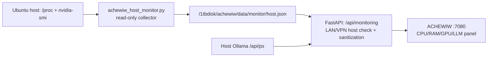

# ACHEWIW — мониторинг хоста, GPU/VRAM и текущей LLM

**Репозиторий:** https://github.com/musikfed/achewiw  
**Рабочая ветка с приложением:** `feature/technical-epub-first`  
**Каталог:** `/1tbdisk/achewiw`  
**Веб-интерфейс после запуска на Huananzhi:** http://192.168.0.100:7080

## Что показывает экран

Панель «Состояние сервера» добавлена на главную страницу студии и обновляется каждые 10 секунд, пока вкладка открыта. API `GET /api/monitoring` доступен **без HTTP Basic в доверенной LAN/VPN**, с проверкой приватного адреса клиента и разрешённого `Host` на FastAPI.

| Поле | Откуда данные | Что означает |
| --- | --- | --- |
| CPU %, число логических CPU, load average | `/proc/stat`, `os.cpu_count()`, `os.getloadavg()` **на Ubuntu-хосте** | Моментальная загрузка всех логических ядер и системная очередь задач |
| RAM, использовано/всего | `/proc/meminfo` с `MemAvailable` | Память всего сервера, включая остальные проекты; это не расход только ACHEWIW |
| GPU %, VRAM использовано/всего, температура | `nvidia-smi` **на Ubuntu-хосте** | Реальная загрузка и память видеокарты, включая **любой** процесс, а не только Ollama |
| LLM выбрана | Выбор автора `#model` в веб-интерфейсе | Модель, которая будет передана в `/api/ai` при следующем запросе |
| LLM по умолчанию | `ACHEWIW_MODEL` из конфигурации приложения | Начальная настройка, необязательно текущая выбранная или загруженная модель |
| LLM реально загружены | Локальная Ollama `GET http://127.0.0.1:11434/api/ps` | Какие модели **сейчас резидентны**, расход VRAM, если Ollama сообщает его |
| LLM установлены | Существующая команда `/api/models` с Ollama `/api/tags` | Установленная модель не обязательно загружена и не обязательно используется |

**Не путать** загрузку GPU/VRAM и выбранную LLM: GPU может использовать чужая задача; выбранная LLM может быть выгружена из памяти; API Ollama `/api/ps` сообщает загруженные модели, но не доказывает, что **именно сейчас идёт генерация ACHEWIW**. Теперь сервер отдельно ведёт активные генерации и черновики в SQLite (`ai_jobs`), без раскрытия промптов в мониторинге. Отдельная карта процесса находится во вкладке StoryEngine.

## Безопасная архитектура



- **Никаких дополнительных HTTP-портов**, расширений firewall, Docker socket, NVIDIA device mounts или привилегий веб-контейнера.
- Сборщик **только читает** `/proc` и `nvidia-smi`, записывает **один** JSON в папку ACHEWIW `data/monitor/`; не трогает другие проекты, модели и процессы.
- Веб-контейнер читает JSON из уже существующего volume `./data:/data`; его права остаются ограниченными. API возвращает только разрешённые метрики без файловых путей, секретов и сведений о чужих процессах.
- Если датчик недоступен, статус `unavailable`; если обновление старше **30 секунд**, статус `stale`. **Не подменять отсутствующие показания нулём.**
- JSON имеет атомарную запись через временный файл + `os.replace`. Приватные `.env`, БД и файлы рукописей не попадают в ответ мониторинга.

## 1. Получить код без запуска

```bash
bash <<'BASH'
set -euo pipefail
cd /1tbdisk/achewiw
if [[ -n "$(git status --porcelain)" ]]; then
  git status --short
  echo "ОСТАНОВКА: есть несохранённые изменения"
  exit 1
fi
git fetch origin
BRANCH=feature/technical-epub-first
if git show-ref --verify --quiet "refs/heads/$BRANCH"; then
  git switch "$BRANCH"
else
  git switch --track -c "$BRANCH" "origin/$BRANCH"
fi
git merge --ff-only "origin/$BRANCH"
git status -sb
git log -1 --oneline
test -f scripts/achewiw_host_monitor.py
test -f app/monitoring_core.py
test -f app/static/monitor.js
echo "Мониторинг скачан. Ничего не запущено."
BASH
```

## 2. Подключить сбор CPU, RAM и NVIDIA на Ubuntu

У веб-контейнера нет прав на видеокарту или Docker socket — это правильно. Для поступления метрик нужен **хостовый процесс**, который обновляет `/1tbdisk/achewiw/data/monitor/host.json` каждые 5 секунд.

В логах 4 ноября обнаружена ошибка проверки после `systemctl --user link`: systemd возвращал `FragmentPath=/home/user/.config/systemd/user/achewiw-metrics-v2.service`, хотя символическая ссылка указывала на правильный unit в `/1tbdisk/achewiw/ops`. Поэтому пользовательский unit был `Loaded: linked`, но `Active: inactive (dead)`. Проверка **исправлена**: теперь она сверяет `readlink -e FragmentPath` с единственным разрешённым исходником, дополнительно проверяя `WorkingDirectory` и `ExecStart`. Чужая служба с таким же именем по-прежнему не запускается.

После обновления GitHub:

```bash
cd /1tbdisk/achewiw
git status -sb
git fetch origin
git merge --ff-only origin/feature/technical-epub-first
bash scripts/monitor-v2.sh start
bash scripts/monitor-v2.sh status
systemctl --user status achewiw-metrics-v2.service --no-pager
```

Если нужен только разовый снимок, не устанавливая/не запуская unit:

```bash
cd /1tbdisk/achewiw
bash scripts/monitor-v2.sh once
```

Проверка фактически полученных данных:

```bash
curl --noproxy '*' -fsS http://127.0.0.1:7080/api/monitoring | python3 -m json.tool
```

В успешном ответе ожидается `"host": {"status": "ok", ...}`. Если статус `stale` или `unavailable`, проверьте `journalctl --user -u achewiw-metrics-v2.service -n 40 --no-pager` и права своего `data/monitor`. Для температуры и загрузки NVIDIA отдельно проверьте `nvidia-smi` на Ubuntu. Даже если NVIDIA недоступна, CPU и RAM должны отображаться при работающем сборщике.

### Компактная панель

Начиная с редакционного оформления `v6` монитор занимает небольшой горизонтальный блок над редактором, с четырьмя короткими карточками. Кнопка «Свернуть» скрывает карточки; состояние сохраняется локально в браузере. Подробная помощь спрятана под ссылкой «Диагностика датчиков и хостового сборщика», но доступна в любой момент. На узких экранах карточки перестраиваются в две колонки или одну.

**Важно:** изменение панели требует пересборки только веб-контейнера `bash scripts/achewiw-control.sh rebuild`. Изменение **хостового скрипта мониторинга** само по себе не требует пересборки Docker; достаточно `bash scripts/monitor-v2.sh start`. Старые рукописи и база при этих действиях не удаляются.

## Выключатель ACHEWIW

**Примечание по жизненному циклу:** новый `achewiw-metrics-v2.service` управляется собственным скриптом `monitor-v2.sh`. Описанный ниже старый выключатель пока проверяет только прежний `achewiw-host-monitor.service`; не делайте вывод, что `stop` автоматически остановил новый v2 collector. Пока требуется отдельная проверка `systemctl --user status achewiw-metrics-v2.service` (и отдельная остановка своей подтверждённой службы при необходимости). Это не касается общей Ollama или других сервисов.


`scripts/achewiw-control.sh stop` после будущего запуска:
1. проверяет **точные Docker-метки** управляемых контейнеров ACHEWIW;
2. если есть user-unit `achewiw-host-monitor.service`, сверяет `FragmentPath=/1tbdisk/achewiw/ops/achewiw-host-monitor.service`, `WorkingDirectory=/1tbdisk/achewiw` и путь к Python-сборщику;
3. останавливает подтверждённые контейнеры ACHEWIW и **только свой подтверждённый user-unit**;
4. не останавливает `ollama.service`, чужие systemd units, другие Docker-проекты, VPN или GPU-процессы.

Если одноимённый user-unit принадлежит другому проекту, `stop` блокируется. Если вручную запустить collector через `--watch` **без user-systemd**, выключатель **не должен угадывать и убивать процесс**: используйте `Ctrl+C` в том терминале. Не запускать монитор через `nohup` или произвольный демонизатор.

**GitHub CI не проверяет установленный драйвер NVIDIA и показатели физического Huananzhi.** Проверяй `nvidia-smi` и `host.json` непосредственно на сервере. Подробнее: [RUNTIME-GENERATION-GPU-SQLITE-RU.md](RUNTIME-GENERATION-GPU-SQLITE-RU.md).
