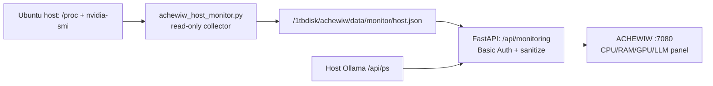

# ACHEWIW — мониторинг хоста, GPU/VRAM и текущей LLM

**Репозиторий:** https://github.com/musikfed/achewiw  
**Рабочая ветка с приложением:** `feature/technical-epub-first`  
**Каталог:** `/1tbdisk/achewiw`  
**Веб-интерфейс после запуска на Huananzhi:** http://192.168.0.100:7080

## Что показывает экран

Панель «Состояние сервера» добавлена на главную страницу студии и обновляется каждые 10 секунд, пока вкладка открыта. API `GET /api/monitoring` находится под **существующей HTTP Basic авторизацией**.

| Поле | Откуда данные | Что означает |
| --- | --- | --- |
| CPU %, число логических CPU, load average | `/proc/stat`, `os.cpu_count()`, `os.getloadavg()` **на Ubuntu-хосте** | Моментальная загрузка всех логических ядер и системная очередь задач |
| RAM, использовано/всего | `/proc/meminfo` с `MemAvailable` | Память всего сервера, включая остальные проекты; это не расход только ACHEWIW |
| GPU %, VRAM использовано/всего, температура | `nvidia-smi` **на Ubuntu-хосте** | Реальная загрузка и память видеокарты, включая **любой** процесс, а не только Ollama |
| LLM выбрана | Выбор автора `#model` в веб-интерфейсе | Модель, которая будет передана в `/api/ai` при следующем запросе |
| LLM по умолчанию | `ACHEWIW_MODEL` из конфигурации приложения | Начальная настройка, необязательно текущая выбранная или загруженная модель |
| LLM реально загружены | Локальная Ollama `GET http://127.0.0.1:11434/api/ps` | Какие модели **сейчас резидентны**, расход VRAM, если Ollama сообщает его |
| LLM установлены | Существующая команда `/api/models` с Ollama `/api/tags` | Установленная модель не обязательно загружена и не обязательно используется |

**Не путать** загрузку GPU/VRAM и выбранную LLM: GPU может использовать чужая задача; выбранная LLM может быть выгружена из памяти; API Ollama `/api/ps` сообщает загруженные модели, но не доказывает, что **именно сейчас идёт генерация ACHEWIW**. Теперь сервер отдельно ведёт активные генерации и черновики в SQLite (`ai_jobs`), без раскрытия промптов в мониторинге. Отдельная карта процесса находится во вкладке StoryEngine.

## Безопасная архитектура



- **Никаких дополнительных HTTP-портов**, расширений firewall, Docker socket, NVIDIA device mounts или привилегий веб-контейнера.
- Сборщик **только читает** `/proc` и `nvidia-smi`, записывает **один** JSON в папку ACHEWIW `data/monitor/`; не трогает другие проекты, модели и процессы.
- Веб-контейнер читает JSON из уже существующего volume `./data:/data`; его права остаются ограниченными. API возвращает только разрешённые метрики без файловых путей, секретов и сведений о чужих процессах.
- Если датчик недоступен, статус `unavailable`; если обновление старше **30 секунд**, статус `stale`. **Не подменять отсутствующие показания нулём.**
- JSON имеет атомарную запись через временный файл + `os.replace`. Приватные `.env`, БД и файлы рукописей не попадают в ответ мониторинга.

## 1. Получить код без запуска

```bash
bash <<'BASH'
set -euo pipefail
cd /1tbdisk/achewiw
if [[ -n "$(git status --porcelain)" ]]; then
  git status --short
  echo "ОСТАНОВКА: есть несохранённые изменения"
  exit 1
fi
git fetch origin
BRANCH=feature/technical-epub-first
if git show-ref --verify --quiet "refs/heads/$BRANCH"; then
  git switch "$BRANCH"
else
  git switch --track -c "$BRANCH" "origin/$BRANCH"
fi
git merge --ff-only "origin/$BRANCH"
git status -sb
git log -1 --oneline
test -f scripts/achewiw_host_monitor.py
test -f app/monitoring_core.py
test -f app/static/monitor.js
echo "Мониторинг скачан. Ничего не запущено."
BASH
```

## 2. Подключить сбор показаний хоста на работающем Huananzhi

На работающем Ubuntu-сервере есть два безопасных режима. Предпочтителен контролируемый user-systemd; команда `start` приложения теперь пытается подключить его автоматически, а `monitor-start` делает то же явно.

**Разовая диагностика (без фоновой службы):**

```bash
cd /1tbdisk/achewiw
python3 scripts/achewiw_host_monitor.py --once
```

Это создаст один JSON в `data/monitor/` и завершится; спустя 30 секунд браузер покажет `stale`. Если запись не разрешена пользователю, следует проверить владельца **только** папки `/1tbdisk/achewiw/data`, а не менять права корня `/1tbdisk`.

**Непрерывный мониторинг (через отдельную управляемую службу):** в репозитории есть `ops/achewiw-host-monitor.service`, предназначенный для **user-systemd** (без root). Перед его включением необходимо проверить `WorkingDirectory`, `ExecStart`, владельца `data/`, доступность `nvidia-smi` и `systemctl --user`.

```bash
cd /1tbdisk/achewiw
mkdir -p data/monitor
bash scripts/achewiw-control.sh monitor-start
bash scripts/achewiw-control.sh status
systemctl --user status achewiw-host-monitor.service --no-pager
nvidia-smi
```

**Запускай эти команды именно на Huananzhi, не внутри контейнера.** Не использовать `sudo systemctl enable`: это отдельная ограниченная пользовательская служба, не системный демон. Она НЕ включается автоматически при загрузке Ubuntu. Если монитор отключён, значения хоста станут `stale`; Ollama продолжает отображаться через отдельный API. Точная ошибка user-systemd: `journalctl --user -u achewiw-host-monitor.service -n 50 --no-pager`.

## Выключатель ACHEWIW

`scripts/achewiw-control.sh stop` после будущего запуска:
1. проверяет **точные Docker-метки** управляемых контейнеров ACHEWIW;
2. если есть user-unit `achewiw-host-monitor.service`, сверяет `FragmentPath=/1tbdisk/achewiw/ops/achewiw-host-monitor.service`, `WorkingDirectory=/1tbdisk/achewiw` и путь к Python-сборщику;
3. останавливает подтверждённые контейнеры ACHEWIW и **только свой подтверждённый user-unit**;
4. не останавливает `ollama.service`, чужие systemd units, другие Docker-проекты, VPN или GPU-процессы.

Если одноимённый user-unit принадлежит другому проекту, `stop` блокируется. Если вручную запустить collector через `--watch` **без user-systemd**, выключатель **не должен угадывать и убивать процесс**: используйте `Ctrl+C` в том терминале. Не запускать монитор через `nohup` или произвольный демонизатор.

**GitHub CI не проверяет установленный драйвер NVIDIA и показатели физического Huananzhi.** Проверяй `nvidia-smi` и `host.json` непосредственно на сервере. Подробнее: [RUNTIME-GENERATION-GPU-SQLITE-RU.md](RUNTIME-GENERATION-GPU-SQLITE-RU.md).
