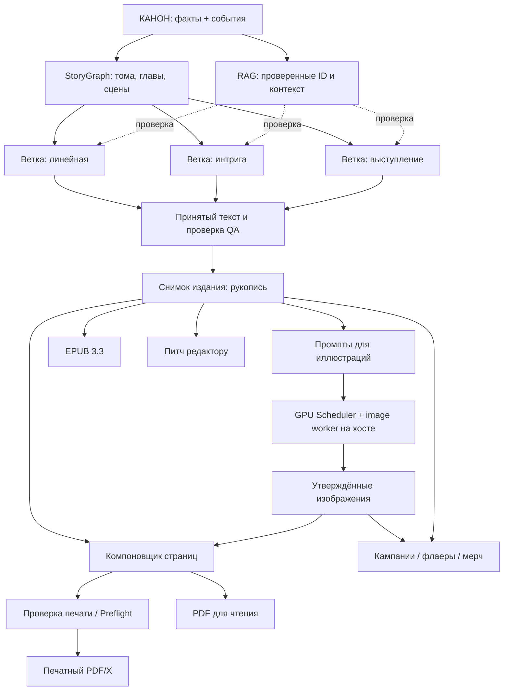
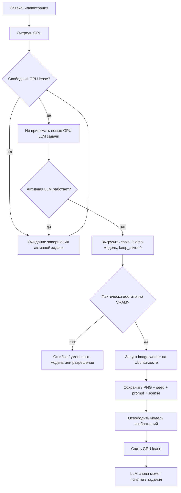
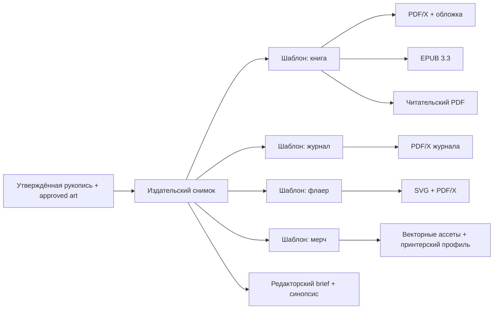

# ACHEWIW · Издательский граф: визуальная карта

> Эта карта — **проект проектирования**, а не уже запущенный серверный редактор. Mermaid можно просматривать прямо в GitHub.

## 1. Сюжет и производство

## 2. Граф управления GPU (RTX 3060 12 GB)

**Важно:** модель изображения нужна отдельная; `qwen2.5vl:7b` в списке Ollama предназначена для восприятия изображений и не выполняет функцию diffusion-модели. Не устанавливать её в контейнер ACHEWIW.

## 3. Граф выпуска разных форматов

## 4. Хранение и обоснование

Граф — не рисунок, а набор записей: `node_id`, `node_kind`, `inputs`, `outputs`, `depends_on`, `resource_type`, `source_snapshot_hash`, `status`, `layout_xy`. Отрисовка — проекция этих данных.

Набор состояний: `pending`, `ready`, `running`, `waiting_author`, `done`, `failed`, `stale`, `cancelled`. Ветвь жанра имеет уникальный `branch_id`; наследование fact ID не копирует и не меняет канон.

**Почему нужна дополнительная карта:** граф событий и граф изготовления отвечают на разные вопросы. «Почему герой оказался там?» — StoryGraph. «Почему эта обложка старая?» — ProductionGraph.
