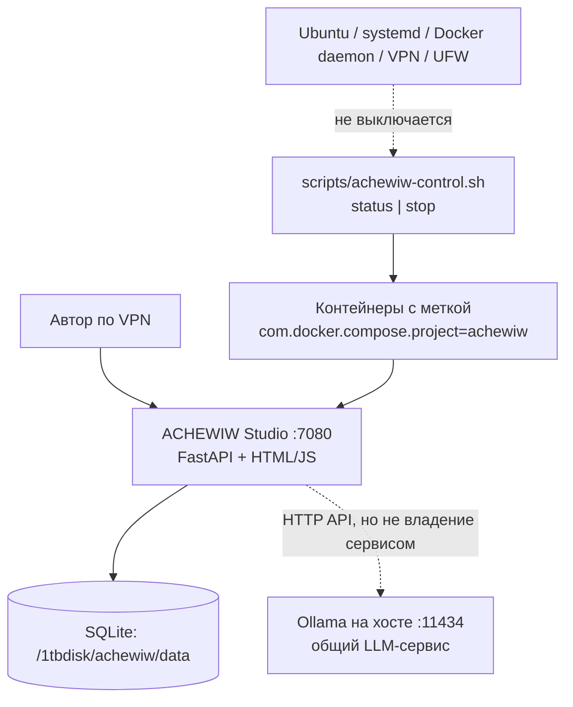

# ACHEWIW — жизненный цикл и полное выключение проекта

**Репозиторий:** https://github.com/musikfed/achewiw
**Каталог на Ubuntu:** `/1tbdisk/achewiw`
**Адрес после будущего запуска:** http://192.168.0.100:7080 (через VPN)
**Статус:** CLI-выключатель добавлен в GitHub, но на сервере ничего не запускалось и ничего не останавливалось.

## Что именно составляет запущенный проект



Сейчас `compose.yaml` задаёт только **одну** службу `studio` с контейнером `achewiw-studio`, `network_mode: host`, слушающую TCP 7080. Ollama установлена и работает отдельно на Ubuntu-хосте, а не в Docker. Будущие иллюстраторы, рендеры, GPU-очередь и прочие воркеры ещё не внедрены.

## Выключатель: уже написан

Из папки проекта (когда проект будет запущен):

```bash
cd /1tbdisk/achewiw
bash scripts/achewiw-control.sh status
bash scripts/achewiw-control.sh stop
```

- `status` показывает состояние контейнеров **только** Compose-проекта `achewiw` и слушателя TCP-порта 7080;
- `stop` посылает Docker SIGTERM контейнерам с меткой `com.docker.compose.project=achewiw`, ждёт до 60 секунд и затем проверяет, что контейнеры перестали работать;
- `stop` **не** вызывает `docker compose down -v`, не удаляет контейнеры/тома/SQLite/образы, не меняет файлы;
- `stop` останавливает весь Compose-проект, включая будущие контейнеры **под той же меткой** (не только `studio`);
- после успешной остановки веб-приложение ACHEWIW не слушает 7080; если порт слушает **чужой** процесс, скрипт предупреждает, **не убивает его**;
- `restart: unless-stopped` в `compose.yaml` не должен автоматически перезапускать вручную остановленный контейнер при обычном перезапуске Docker;
- `status` и `stop` не запускают проект. Команды `start`, `up`, `restart` **намеренно не реализованы**: запуск и настройку автор согласует позднее;
- если у пользователя нет доступа к Docker, script остановится с ошибкой. Можно использовать `sudo bash scripts/achewiw-control.sh stop`, если это разрешено политикой администратора; **не** менять права `docker.sock` через chmod 666.

Отключение порта означает отсутствие слушателя ACHEWIW. Открытое правило UFW `7080` может оставаться на месте: оно не запускает никакую службу. Для полного закрытия доступа по firewall нужна отдельная операция, а не выключатель ACHEWIW.

### Ограничения

- Никаких вызовов `pkill python`, `fuser -k 7080/tcp`, `systemctl stop ollama`, `docker stop $(docker ps -q)`, `docker compose down -v` и других команд, влияющих на сторонние сервисы.
- Запрос, уже отправленный в Ollama, может завершиться на стороне Ollama после остановки веб-контейнера. Скрипт не выгружает модели, не отменяет чужие задания и не освобождает VRAM принудительно.
- При активной длительной генерации `docker stop --time 60` может прервать ответ. Перед ручным выключением сохраните текст и дождитесь окончания задач; в будущем добавить автоматический drain.
- Если в будущем появится **отдельный host image-worker**, systemd unit, scheduler или внешний рендерер, он **не** управляется Docker Compose и пока **не охвачен** действующим скриптом. Не обещать «выключено всё» до объединения этих сервисов под выделенным менеджером проекта.

## Будущий выключатель в веб-интерфейсе

Требование продукта: на странице ACHEWIW в настройках кнопка **«Выключить мастерскую»**. После нажатия:

1. Автор проходит аутентификацию и видит подтверждение; UI показывает активные задачи, несохранённые правки и наличие неподтверждённого текста.
2. Сервер переводит проект в `draining`: запрещает начало новых задач, ожидает завершения/согласованной отмены текущих, фиксирует версию сохранённого текста и состояние SQLite.
3. Отдельный **минимально привилегированный host supervisor** принимает одно разрешённое действие `stop achewiw`. Он **не** принимает произвольные shell-команды, пути, имена контейнеров или команды управления Ollama.
4. Supervisor завершает именно экземпляр ACHEWIW и будущие зарегистрированные воркеры. Страница до отключения объясняет: «После выключения адрес 7080 станет недоступен».
5. Для повторного включения пользователь применит будущий **отдельный** безопасный скрипт запуска на хосте. Нельзя включить остановленное приложение кнопкой на уже выключенном веб-сервере.

Безопасность: ни в каком виде **не монтировать `/var/run/docker.sock` в веб-контейнер**, не выдавать FastAPI root или доступ к произвольному `systemctl`, не публиковать endpoint выключения без отдельной авторизации и CSRF-защиты (HTTP Basic сам по себе не решает CSRF). Предусмотреть подтверждение, rate limiting, локальный журнал действий и строгую границу полномочий между веб-приложением и host supervisor.

**Статус веб-кнопки:** только архитектурное ТЗ. Host supervisor, `draining`, интерфейсная кнопка и запуск проекта ещё **не реализованы**.

## Критерии готовности

- На тестовом сервере `stop` прекращает обработку ACHEWIW на 7080 и не затрагивает Ollama на 11434.
- Иные Compose-проекты не останавливаются, их тома/каталоги/данные не изменяются.
- ACHEWIW `data/` и Git workspace сохраняются, повторный `stop` безопасен.
- При чужом сервисе на 7080 выдаётся предупреждение; чужой процесс не уничтожается.
- Веб-кнопка впоследствии получает отдельный тест защищённости и сценарий активной генерации.
- Скрипт `stop` сам никогда не запускает Docker-контейнеров и не выполняет действий над сервером без прямого вызова пользователем.

Связанная инструкция GitHub ↔ Ubuntu: [GIT-SERVER-SYNC.md](GIT-SERVER-SYNC.md).
