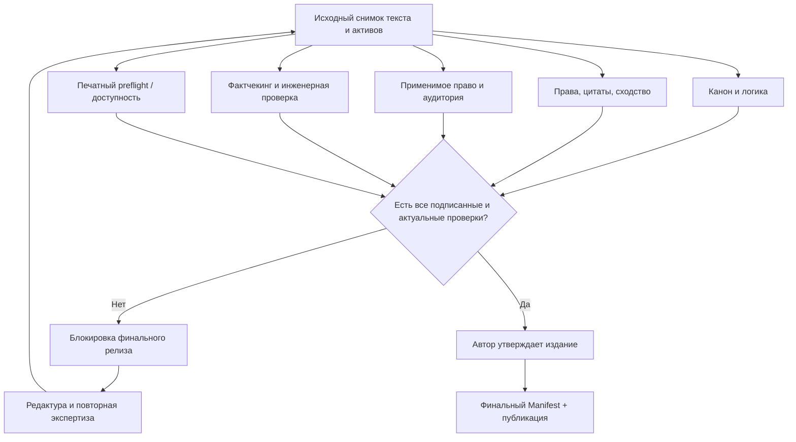
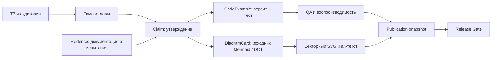

# ACHEWIW — карта допуска и технического учебника

## Контроль выпуска

Проверки — независимые задачи и версии; `similarity_score` служит для triage, а не является законной «долей плагиата». Каждый юридический вывод касается явно указанной страны публикации.

## Техническая книга и доказательная база

В техническом проекте канон художественного мира **не подменяет** источник истины: утверждения проверяются по документации или экспериментам. Их статус может стать `outdated` при смене версии API, прошивки или стандарта.

## Требования к профессиональным схемам

- Системные UML/ER/сетевые и workflow схемы: Mermaid, Graphviz/DOT, PlantUML; SVG и редактируемый исходник.
- Формулы: LaTeX/MathML, размерности, специальные символы и совместимость с доступным форматом.
- Электроника: реальная EDA-схема (например, KiCad) отдельно от декоративного рисунка; ERC, проверка номиналов и посадочных мест.
- Факты: source IDs, версии документов, дата проверки, review evidence.
- Безопасность: любые команды из технических книг запускать только в отдельной явно разрешённой песочнице, не на рабочем сервере по умолчанию.

**Статус:** схема, модель Python и пример JSON в feature/release-gate-technical-books. Не подключены к уже работающему UI, не проходили правовую экспертизу, не выводят готовые книги.
