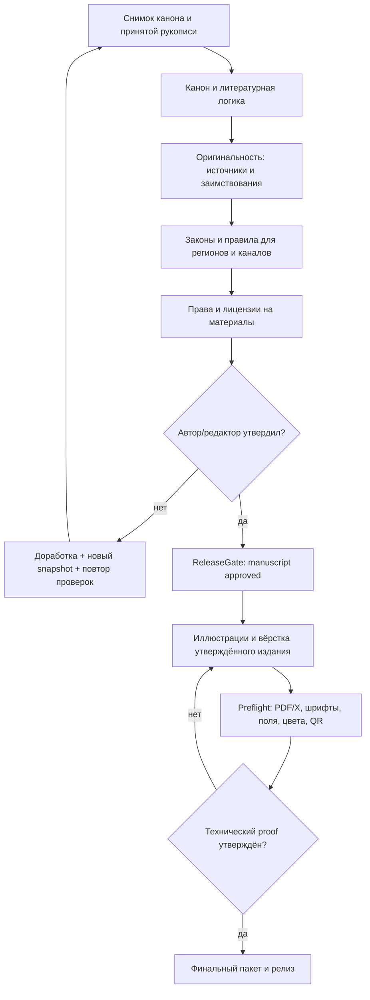

# RFC-0004 · ReleaseGate: редакционная проверка перед публикацией

**Статус:** проект спецификации. Не заявлять, что ACHEWIW уже умеет юридически сертифицировать текст или определять «процент плагиата».

## Принцип

> **Публикация — это отдельное разрешённое действие, а не побочный эффект генерации текста или экспорта.**
>
> Закулисная мастерская может в любой момент давать черновой предпросмотр. Выпуск финального PDF/X, EPUB, публичного PDF, маркетингового тиража и передача в типографию доступны только после *ReleaseGate* и финального технического preflight.

Шлюз работает на **конкретном неизменяемом снимке издания** (`edition_id`, `canon_hash`, `manuscript_hash`, `asset_hashes`, `jurisdictions`, `distribution_channels`). Если утверждённый текст, обложка, иллюстрация, профиль региона или канал распространения изменились, связанная проверка получает `stale`, разрешение на выпуск более не действительно.

## Обязательные проверки

| Gate | Что проверяем | Источники | Решение |
|---|---|---|---|
| `canon` | События, хронология, причина/следствие, POV, место и время, непротиворечивость правил мира, выполнение обещанных разгадок | Утверждённые `CanonFact`, `WorldEvent`, точные card IDs, текст | Автоматические структурные ошибки + экспертный обзор смысловых отклонений |
| `originality` | Существенные текстовые совпадения, заимствованные иллюстрации, цитаты, атрибуция, подозрение на близкий пересказ | Внутренняя база, доступные авторизованные внешние корпуса, ссылки на источники | **Никакого универсального «законного процента плагиата»**; отчёт по совпадениям и ручная оценка |
| `jurisdictional_content` | Возможные ограничения для выбранного региона, возраста и канала распространения: в том числе применимые запреты на отдельные виды пропаганды, призывов и иных публикаций, где это действительно определено законом | Версия набора применимых правил, выбранные `jurisdictions`, контекст содержания | Флаги и цитируемые основания для юридической/редакторской проверки; LLM **не** даёт гарантии законности |
| `rights` | Авторские права, лицензии/разрешения на текст, шрифты, изображения, модели/ассеты, согласия на использование, бренд и мерч | Asset manifest, лицензии, документы правообладателей | Отсутствующие доказательства останавливают выпуск либо требуют явного решения уполномоченного рецензента |
| `editorial` | Утверждение человеком финальных правок, заявлений, маркировок, возрастной информации, редакторского синопсиса и упаковки | Акт утверждения автора/редактора, снимок издания | Ручное `approved`, никакого автоматического `pass` от одной LLM |

**Не превращать оценку политики в идеологическую цензуру.** Для спорных тем контекст художественного произведения имеет значение. Системе нужны конкретные применимые правила, источники и объяснение риска; общая маркировка «пропаганда» без ссылки на норму и юрисдикцию не может служить основанием автоматического отказа.

## Почему процента плагиата не существует как универсальной нормы

- «Совпадение 15%» само по себе не доказывает ни нарушение, ни его отсутствие. Заимствование нескольких ярких абзацев может быть значимее длинной корректно оформленной цитаты.
- Процент зависит от корпуса поиска, языка, алгоритма, коротких устойчивых выражений, настроек исключения библиографии и цитат.
- Неизвестный или отсутствующий внешний корпус = **неполное покрытие**, а не нулевой риск.
- Метрики полезны как сигнал к проверке: `matched_span_count`, `longest_span_words`, `source_urls`, `similarity_score`, `coverage_note`, `quotes_with_attribution`, `review_required`.
- `review_trigger` может быть настраиваемым редакционным порогом для **ручной проверки**, но никогда не называется «допустимым законом процентом».
- Проверка смысловой переработки и возможной производности работы требует отдельного анализа; машинный similarity score не заменяет проверки прав.

### Пример

У сочинения высокий процент совпадений с произведениями в общественном достоянии, автор корректно атрибутирует фрагменты — это не тождественно незаконному плагиату. И наоборот, один чужой сюжетный отрывок, воспроизведённый без разрешения и должного основания, требует внимания даже при низком общем проценте.

## Жизненный цикл

Создание иллюстраций и пробных макетов может происходить **раньше** для внутреннего рецензирования, но финальная версия активов и итогового PDF должна повторно пройти проверку прав и контента. Финальные экспортёры зависят от `editorial_gate`; внешняя публикация зависит дополнительно от preflight.

## Структура записи

`GateResult`:
- `gate_id`, `kind`, `edition_id`, `source_hash`;
- `status=pending|passed|needs_review|failed|stale`;
- `evidence[]` (цитаты источников и точные места текста), `scope` (главы/рисунки);
- `tool_version`, `ruleset_version`, `reviewer_id`, `reviewed_at`, `notes`.

`ReleaseApproval`:
- `edition_id`, `source_hash`, `jurisdictions[]`, `distribution_channels[]`, `required_gate_ids[]`;
- `approved_by`, `approved_at`, `signed_manifest_hash`, `expires_on_change=true`.

Публикация запрещена, если хотя бы один обязательный gate = `pending`, `needs_review`, `failed`, `stale`, или `source_hash` не совпал. Важное: «passed» означает завершённую проверку в **заданном объёме и на текущих данных**, а не гарантию от претензий.

## UX: четыре режима выпуска

1. **Черновик:** свободный предпросмотр в редакторе, пометка DRAFT / рабочая версия.
2. **На проверке:** отчёт с конкретными находками и маршрутами исправлений, нельзя публично выпускать.
3. **Готово к препрессу:** все обязательные редакционные проверки утверждены, можно собирать печатные форматы.
4. **Готово к выпуску:** preflight и печатная проба утверждены, подписан manifest, доступны экспорт, отправка типографии и публикация.

Программный выход из заблокированного состояния только после явных решений и логируемых обоснований. Не обходить правовые ограничения нажатием «игнорировать» без дальнейшего рассмотрения.

## Матрица тестов

- Неизвестная юрисдикция или канал — блокировать финальный выпуск до выбора профиля.
- Новый абзац меняет `manuscript_hash` → все соответствующие заключения устаревают.
- Изменение обложки/иллюстрации меняет `asset_hashes` → права/контент и preflight необходимо обновить.
- Недостаточное покрытие источников не интерпретировать как отсутствие совпадений.
- Вопросы литературы и закона не решать чисто одним LLM-классификатором.
- Этап `publish.pdfx`, `publish.ebook`, `marketing.package` не может обойти release gate.
- Автор всегда видит, какие именно карточки и цитаты вызвали замечание.

## Порядок реализации

**После P0 канона и версий:** P1 подготовить запись GateResult/approval и применение зависимости к DAG; P2 проверить источники/оригинальность и конфигурируемые legal ruleset; P3 UI редакторского отчёта; перед P4/P5 производственными экспортёрами обеспечить реальные gating tests. Никакой установки и запуска на Ubuntu на этом шаге.
