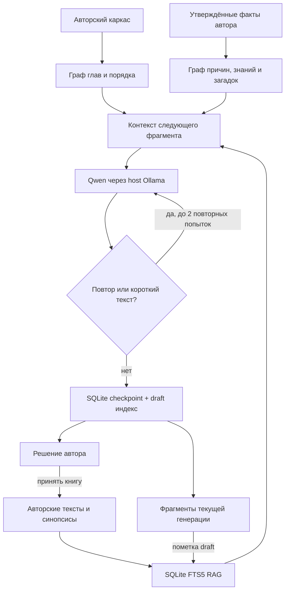

# StoryEngine: память романа (RAG + граф) — рабочий фундамент

## Проблема, которую устраняет слой памяти

При испытании «Филиниусы» локальная Qwen записала 1 266 из 20 000 слов и остановилась на повторе абзаца. До этой версии каждый запрос видел хвост текущей главы и весь план, но не имел устойчивого реестра связей и доступного поиска по прошлому. Увеличение `num_ctx` само по себе не гарантирует связность.

## Реализовано

- **Одна локальная SQLite, без Neo4j/Postgres и новых контейнеров.** При старте студии добавляются только таблицы `story_*`. Старые проекты, `ai_book_chapters`, `author_text_revisions`, иллюстрации и SQLite остаются неизменными.
- **Автоматический граф плана:** главы являются особыми узлами `status=outline` и рёбрами `before`. Они отражают авторский каркас, но **не считаются доказанными фактами мира**. При изменении порядка граф пересобирает только собственные связи порядка.
- **Подтверждённые автором узлы:** `event`, `character`, `object`, `place`, `fact`, `mystery`, `rule`. Кнопка «Закрепить в памяти» создаёт узел `status=approved` с авторской формулировкой и ссылкой на первую главу появления.
- **Явные рёбра:** `causes`, `requires`, `before`, `foreshadows`, `reveals`, `knows`, `holds`, `contradicts`. На входе блокируются причинные циклы, ссылки на другой проект/ветку и причины позже следствий. Аудит сообщает о ещё не раскрытых загадках и некоторых нарушениях порядка подсказка/разгадка.
- **RAG-поиск через FTS5:** сохранённые авторские главы и краткие синопсисы индексируются как `approved`/`synopsis`. После каждого принятого фрагмента генерации он отдельно индексируется как `draft`. Для запроса выбираются только материалы **этого проекта**, **той же задачи** и **не более поздней главы**; источник каждого фрагмента явно маркируется. Семантические эмбеддинги пока не подключены.
- **Сохранённые старые черновики:** при возобновлении задания индексируется уже существующий текст текущей главы, например первые 1 266 слов. Никакой очистки или переписывания главы ради индексации не требуется.
- **Генератор:** в `_book_prompt` добавляется компактная подборка релевантных авторских фактов, связей, карточек и фрагментов. Информация из непринятого текста считается контекстом продолжения, но никогда не превращается в авторский канон автоматически.
- **Защита от петель:** после обнаружения дословного повтора предыдущий текст сохраняется; модель получает до двух дополнительных попыток с новым seed и требованием продвинуть конкретное действие. Если три попытки неудачны, задание останавливается без повреждения рукописи и допускает `resume`.
- **Изолированные ветки графа** имеют собственный ID и родительскую ветку. Пока это пространство для экспериментальных фактов/связей; генерация альтернативной полноценной рукописи **ещё не реализована**. Основная генерация пишет только `main`.

## Схема



## Использование

Обнови проект только когда нет активной генерации:

```bash
cd /1tbdisk/achewiw
bash scripts/update-studio-clean.sh preview
bash scripts/update-studio-clean.sh apply
```

Потом Ctrl+Shift+R → «Филиниусы» → **02 · План** → «Память сюжета · RAG + граф причин». Граф порядка глав появится сам. Добавь несколько реальных опорных событий, открытых загадок, персонажей и рёбер; сначала выдели факт, затем связь. В **06 · Типография** нажми «Продолжить написание»: при наличии сохранённых 1 266 слов текст сохранится и будет индексирован перед новым запросом.

## Ограничения и безопасность

1. RAG не проверяет правдивость похожего текста. Только авторский `approved` — канон; `draft` лишь контекст.
2. Графовая проверка структурная: циклы, порядок и явные связи. Она **не обнаружит автоматически всякое сюжетное противоречие** в тексте, пока факт не внесён в граф; поэтапная LLM-разметка с авторским принятием — следующий слой.
3. Альтернативная ветка сейчас хранит отдельные узлы и связи; полноценные ветвящиеся романы и наследование до точки развилки ещё не подключены к генератору.
4. Обновление не удаляет `/1tbdisk/achewiw/data`, не выполняет Docker prune и не перезапускает хостовую Ollama или проекты соседних каталогов.
5. CI проверяет API, SQLite, запреты на чужие проекты/задачи, существующие черновики и защиту причин. Реальный запуск 20 000 слов на твоей RTX 3060 нужно проверять на сервере.
