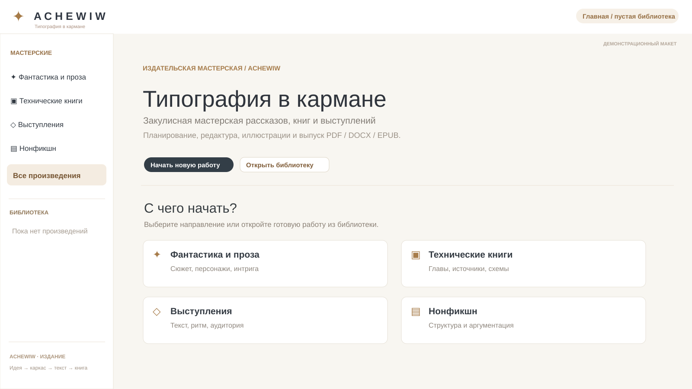

# achewiw · Visual project showcase

**Локальная издательская студия · Local book publishing studio**

**Project stages:** Book idea → Canon / RAG → Local LLM roles → PDF / EPUB / DOCX. **Status:** prototype.

**Language note:** these are translations of the project *presentation*, not a claim that the software interface supports eleven languages. The descriptions are based on the repository documentation and are not a hardware/production certification.

### Русский (ru)
Локальная студия создания, редактуры и выпуска книг. **achewiw** — Book idea → Canon / RAG → Local LLM roles → PDF / EPUB / DOCX.

### English (en)
Local AI studio for writing, reviewing and publishing books. **achewiw** — Book idea → Canon / RAG → Local LLM roles → PDF / EPUB / DOCX.

### 简体中文 (zh)
本地 AI 图书写作、审校与出版工作室。 **achewiw** — Book idea → Canon / RAG → Local LLM roles → PDF / EPUB / DOCX.

### Deutsch (de)
Lokales KI-Studio zum Schreiben, Prüfen und Veröffentlichen von Büchern. **achewiw** — Book idea → Canon / RAG → Local LLM roles → PDF / EPUB / DOCX.

### हिन्दी (hi)
पुस्तक लेखन, समीक्षा और प्रकाशन के लिए स्थानीय AI स्टूडियो। **achewiw** — Book idea → Canon / RAG → Local LLM roles → PDF / EPUB / DOCX.

### Français (fr)
Studio IA local pour écrire, réviser et publier des livres. **achewiw** — Book idea → Canon / RAG → Local LLM roles → PDF / EPUB / DOCX.

### Suomi (fi)
Paikallinen tekoälystudio kirjojen kirjoittamiseen, tarkistamiseen ja julkaisuun. **achewiw** — Book idea → Canon / RAG → Local LLM roles → PDF / EPUB / DOCX.

### 한국어 (ko)
책 집필·검토·출판을 위한 로컬 AI 스튜디오. **achewiw** — Book idea → Canon / RAG → Local LLM roles → PDF / EPUB / DOCX.

### 日本語 (ja)
執筆、編集、電子書籍のローカル制作環境。 **achewiw** — Book idea → Canon / RAG → Local LLM roles → PDF / EPUB / DOCX.

### Italiano (it)
Studio locale per scrittura, revisione e pubblicazione di libri. **achewiw** — Book idea → Canon / RAG → Local LLM roles → PDF / EPUB / DOCX.

### Беларуская (be)
Лакальная студыя напісання, рэдагавання і выдання кніг. **achewiw** — Book idea → Canon / RAG → Local LLM roles → PDF / EPUB / DOCX.

## Contacts · Контакты

- Telegram: [@Feudorlab1](https://t.me/Feudorlab1)
- Email: [feudor.lab@yandex.ru](mailto:feudor.lab@yandex.ru)
- Email: [obzorniky@gmail.com](mailto:obzorniky@gmail.com)
- Website: [peginelab.ru](https://peginelab.ru/)
- GitHub: [achewiw](https://github.com/musikfed/achewiw)

**Source of truth:** the root README and technical documentation in this repository. Experimental features are not guaranteed finished. 
