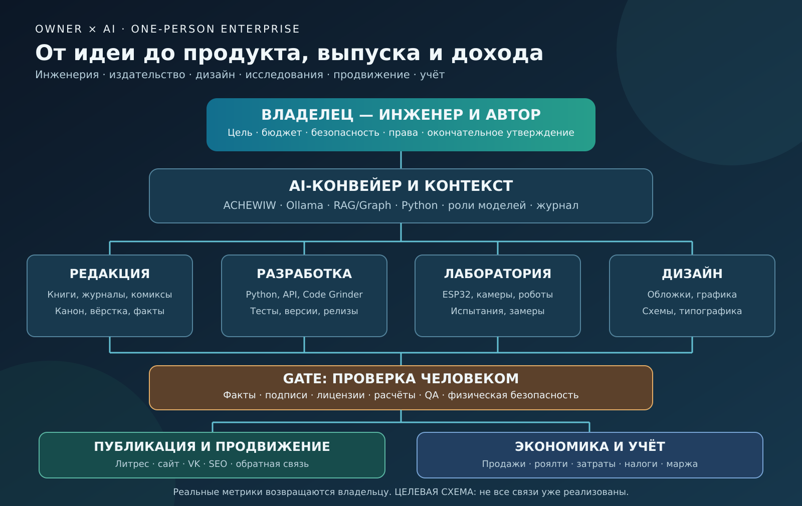

# OWNER × AI · самостоятельное инженерно-издательское предприятие

**«Слово чтимое — чудо дивное».** Версия плана: 23.11.2026, v0.1.

## Идея

Создать **предприятие полного цикла под личным управлением одного инженера**, где собственные AI-инструменты помогают выполнять инженерные R&D, разработку ПО, выпуск книг/журналов/комиксов, дизайн, продвижение и финансовый анализ. Человек определяет продукт, подтверждает результаты испытаний, утверждает тексты, публикации и платежи. AI — двигатель процессов, **не самостоятельный правообладатель или директор**.

**Это стратегия, не заявление о полном техническом внедрении**. Уже есть собственные проекты, патентованная программа PiTools, публикации на Литрес, локальные модели и ACHEWIW. Нет оснований утверждать подтверждённые продажи, прибыль или заказы внешних клиентов без документов. Публикация книги — продуктовый результат; коммерческий доход подтверждается отчётами платформ.

## Папка — только независимые документы

- [01-roadmap.md](01-roadmap.md) — пошаговый чеклист создания и развития бизнеса, критерии готовности.
- [02-production.md](02-production.md) — редколлегия, лабораторные опыты, инженерное производство, quality gate.
- [03-prompts.md](03-prompts.md) — промпты AI-координатора, авторского конвейера, рецензирования, дизайна, SEO, экономики.
- [04-marketing-seo.md](04-marketing-seo.md) — запуск продукта, Литрес, VK, peginelab.ru, SEO и аналитика.
- [05-finance.md](05-finance.md) — фактические роялти, выручка, затраты, себестоимость, налоги и учёт.
- [06-start-runbook.md](06-start-runbook.md) — безопасный запуск существующей ACHEWIW и одного цикла.
- [07-visual-brief.md](07-visual-brief.md) — полное описание схемы и промпты для её воспроизведения.
- [templates/](templates/) — пустые CSV-шаблоны, **не реальные финансовые данные**.

## Существующие проекты и продажи

- [ACHEWIW](../README.md) — локальный редакционно-издательский конвейер с Ollama, RAG/Graph, SQLite, генерацией черновиков и авторским утверждением; работа по книге, а не автономное коммерческое предприятие.
- [Code Grinder](https://github.com/musikfed/Code-Grinder) — проверяемая обработка изменений кода.
- [PiTools](https://github.com/musikfed/pitools), [Hombo3](https://github.com/musikfed/Hombo3_3.0.0), [WifCam Helper](https://github.com/musikfed/wifcam_helper) — инженерные инструменты и экспериментальная лаборатория.
- Реальные публикации: [Литрес № 74801374](https://www.litres.ru/74801374/), [74823258](https://www.litres.ru/74823258/), [74859298](https://www.litres.ru/74859298/). Названия, права, продажи, роялти и выплаты подтверждать в личном кабинете.
- Каналы: https://peginelab.ru/ , https://musikfed.github.io/view_my_prj/ , VK, авторские страницы.

**Ограничение изменений:** этот пакет не должен менять исходники ACHEWIW, процессы, CI, корневой README, базы, работающий сайт, секреты или SSH-настройки. Любая автоматизация публикации, налоговых действий, запуска моделей, покупки рекламы и изменения устройств требует отдельной разработки, проверки и разрешения владельца.
